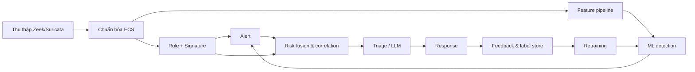

# Báo cáo nghiên cứu: Tích hợp AI/ML vào NDR dựa trên Zeek

> Tài liệu này trả lời câu hỏi: **AI/ML nên được tích hợp vào hệ thống NDR hiện tại như thế nào, ở đâu, bằng mô hình gì, và vì sao?**  
> Thiết kế triển khai chi tiết nằm trong [`02-system-design.md`](./02-system-design.md); kế hoạch thực hiện nằm trong [`03-implementation-plan.md`](./03-implementation-plan.md).

---

## 1. Tóm tắt điều hành

Hệ thống NDR hiện tại đã có nền tảng rất tốt: Zeek cung cấp metadata đầy đủ cho conn/DNS/HTTP/TLS/SMB/SSH/file, Suricata bắt signature, Intel Framework đối chiếu IOC, Elasticsearch/Kibana lưu trữ và trực quan hóa, response service tự động chặn IP. Điểm yếu không nằm ở khả năng thu thập log mà ở **khả năng phát hiện các hành vi không có chữ ký, giảm cảnh báo nhiễu, tương quan nhiều nguồn và thích nghi với biến thể tấn công**.

Nghiên cứu các hệ thống mã nguồn mở và công trình gần đây cho thấy hướng hiệu quả nhất là **hybrid detection**:

- Giữ rule/signature làm lớp 0 vì precision cao và chi phí thấp.
- Thêm **unsupervised anomaly detection** trên log Zeek để phát hiện bất thường chưa biết, học từ baseline lưu lượng bình thường.
- Thêm **supervised detector** cho các hành vi có cấu trúc đặc trưng: C2 beaconing, DNS tunneling, lateral movement, malware download.
- Dùng **risk fusion** để gộp rule alert, anomaly score, xác suất model, threat intel và độ quan trọng tài sản thành một hàng đợi cảnh báo duy nhất.
- Dùng **LLM có kiểm soát** cho triage/giải thích, không dùng LLM làm bộ phát hiện chính và không cho LLM tự động chặn.
- Đầu tư tối thiểu vào **MLOps**: label store, model registry, đánh giá theo kịch bản, drift monitoring, retraining có shadow/canary và rollback.

Khuyến nghị triển khai out-of-band: **Filebeat → Redis list/Kafka → feature worker → ML inference → Elasticsearch → risk engine → response**, chạy trên VM ML riêng trong vùng MGMT. Cách này không tranh tài nguyên với Zeek, cho phép replay, cập nhật model độc lập và mở rộng lên production.

---

## 2. Bối cảnh và khoảng trống của NDR hiện tại

### 2.1 NDR hiện tại mạnh ở đâu

| Thành phần | Vai trò | Điểm mạnh |
|---|---|---|
| Zeek | Sinh log giao thức có cấu trúc | Visibility đầy đủ, có `uid` để nối log, script hướng sự kiện, Intel Framework, JA3/JA4 cho TLS |
| Suricata | Signature IDS | Bắt exploit/malware đã biết, `eve.json` giàu metadata |
| Filebeat + Elasticsearch | Ingest, lưu trữ, tìm kiếm | Chuẩn hóa ECS, lưu 12 tháng theo ILM, query mạnh |
| Kibana | Dashboard, rule, điều tra | Trực quan hóa, drill-down theo thời gian/host/uid |
| Response service | Tự động chặn + thông báo | Giảm thời gian phản ứng, có thể mở rộng playbook |
| Zeek script + Suricata + Intel | Detection lớp 0 | Precision cao với hành vi đã biết |

### 2.2 Khoảng trống theo từng kịch bản

| # | Kịch bản | Cách phát hiện hiện tại | Điểm mù chính | AI/ML có thể bổ sung |
|---|---|---|---|---|
| 1 | Port scan (nmap) | SumStats đếm số cổng đích/REJ/S0 trong cửa sổ | Scan chậm, scan phân tán nhiều nguồn, scan IPv6, scan một phần | Window anomaly + graph fan-out; phân biệt scan hợp lệ (monitoring) với scan tấn công |
| 2 | Brute force SSH/FTP | Notice `SSH::Password_Guessing`, đếm reply 530 | Low-and-slow, credential stuffing, nhiều nguồn, thay đổi nhịp | Sequence/rate model; phát hiện phân phối thử nghiệm bất thường |
| 3 | Malware download | IOC hash/domain + Suricata signature | Malware chưa biết, living-off-the-land, payload mã hóa | Behavior model trên HTTP/file/TLS; kết hợp intel như feature |
| 4 | C2 beaconing | Phân tích thủ công chu kỳ, độ lệch chuẩn khoảng thời gian | Jitter, nhiều kênh, domain fronting, beacon qua TLS | Time-series/FFT/autocorrelation + supervised classifier |
| 5 | Lateral movement SMB/PsExec | Rule ADMIN$/C$, file `.exe`, svcctl | Biến thể dùng credential, RDP/WinRM, công cụ hợp lệ | Graph/sequence model trên SMB + DCE/RPC + host pair |
| 6 | DNS tunneling | Độ dài subdomain, entropy, số query | Low-entropy tunnel, DoH, domain fronting, query thưa | Lexical + window features + classifier; phát hiện phân phối bất thường |

### 2.3 Khoảng trống chung

- **Alert fatigue:** nhiều cảnh báo rời rạc, thiếu ưu tiên, analyst khó biết bắt đầu từ đâu.
- **Thiếu tương quan:** một sự kiện nằm rải rác trong conn/DNS/HTTP/TLS/SMB; hiện tại chủ yếu ghép thủ công bằng `uid`/`community_id`.
- **Ngưỡng tĩnh:** rule dùng ngưỡng cố định, dễ bỏ sót khi lưu lượng thay đổi hoặc attacker điều chỉnh nhịp.
- **Không có feedback loop:** cảnh báo đúng/sai không được ghi lại để cải thiện rule/model.
- **Không có đánh giá định lượng:** chưa đo precision/recall/FP theo từng kịch bản, chưa có baseline trước khi thêm ML.
- **Không có MLOps:** model nếu có sẽ khó version, khó tái lập, khó phát hiện drift.

---

## 3. AI/ML can thiệp vào đâu trong vòng đời NDR

AI/ML không chỉ là "model phát hiện tấn công". Có sáu điểm can thiệp:

| Giai đoạn | Use case | Loại AI/ML | Giá trị | Rủi ro |
|---|---|---|---|---|
| Detect | Anomaly detection trên flow/log | Unsupervised | Bắt hành vi chưa biết | Nhiễu, khó giải thích |
| Detect | Phân loại họ tấn công | Supervised | Precision/recall cao hơn rule | Cần label, dễ overfit |
| Triage | Tóm tắt, giải thích, gợi ý bước tiếp theo | LLM + RAG | Giảm thời gian đọc alert | Hallucination, prompt injection |
| Correlate | Ghép sự kiện thành chuỗi kill chain | Graph/rule/score | Giảm alert trùng, thấy bức tranh tổng thể | False correlation |
| Hunt | Tìm host/flow giống mẫu, clustering | Similarity/unsupervised | Hỗ trợ threat hunting | Khó đánh giá |
| Respond | Ưu tiên và chọn hành động | Scorecard/RL (không khuyến nghị RL) | Phản ứng nhất quán | Tự động hóa sai |
| Learn | Feedback từ analyst, retraining | Active learning | Cải thiện dần | Label noise, drift |



**Nguyên tắc:** ML không nằm trên đường tới hạn của packet capture. Nếu ML service lỗi, rule và response hiện có vẫn phải hoạt động.

---

## 4. Phân loại phương pháp và lựa chọn

### 4.1 Các họ phương pháp

| Phương pháp | Dữ liệu cần | Ưu điểm | Nhược điểm | Phù hợp |
|---|---|---|---|---|
| Signature/rule | Chuyên gia, IOC | Precision cao, nhanh, dễ giải thích | Không bắt biến thể, bảo trì tốn công | Hành vi đã biết, compliance |
| Unsupervised anomaly | Baseline bình thường | Không cần label, bắt cái mới | Nhiễu, khó giải thích, drift | Lớp phát hiện bổ sung, hunting |
| Supervised classification | Label tấn công/bình thường | Accuracy cao trên phân phối đã học | Cần label, dễ overfit, không bắt cái mới | Kịch bản có cấu trúc rõ |
| Semi-supervised | Ít label + nhiều unlabeled | Tận dụng dữ liệu chưa label | Phức tạp, khó đánh giá | Khi label khan hiếm |
| Hybrid | Kết hợp | Cân bằng precision/recall/giải thích | Thiết kế và vận hành phức tạp hơn | **Khuyến nghị cho đồ án** |

### 4.2 Độ chi tiết của detection

| Mức | Đơn vị | Ví dụ | Thế mạnh | Hạn chế |
|---|---|---|---|---|
| Packet | Gói tin | Payload signature | Chi tiết | Không scale, mã hóa |
| Flow | 5-tuple | conn.log anomaly | Nhanh, phổ biến | Mất ngữ cảnh chuỗi |
| Session | Transaction | HTTP/DNS/TLS | Giàu ngữ cảnh | Cần ghép log |
| Host/entity | IP/host | Entity profile | Bắt hành vi tổng thể | Cần baseline |
| Graph | Host pair | Lateral movement | Thấy lan truyền | Cần dữ liệu đủ lớn |
| Campaign | Chuỗi sự kiện | Kill chain | Đúng ngữ cảnh tấn công | Khó label, latency cao |

### 4.3 Online và offline

- **Online/streaming:** phục vụ cảnh báo gần thời gian thực; cần stateful window, chịu được late data, có backpressure.
- **Offline/batch:** huấn luyện, đánh giá, hunting, tái tạo feature; dùng Parquet/Spark/DuckDB.
- **Yêu cầu quan trọng:** cùng một định nghĩa feature cho cả online và offline để tránh **train/serve skew**.

### 4.4 Bài học từ thực tiễn

1. **Feature quan trọng hơn model.** Với log Zeek, feature hành vi (chu kỳ, fan-out, entropy, tỷ lệ lỗi) thường quyết định chất lượng hơn việc chọn thuật toán.
2. **Không dùng một model cho mọi log.** Mỗi log có ngữ nghĩa khác nhau; nên chọn detector theo log type.
3. **Tương quan chéo log là vũ khí chính.** Cùng một `uid` xuất hiện trong conn + http + files + weird có giá trị hơn một outlier đơn lẻ.
4. **Unsupervised chỉ là điểm khởi đầu.** Nó xếp hạng bất thường, không khẳng định tấn công; cần supervised/risk fusion để hành động.
5. **Đánh giá trên dữ liệu của chính mình.** Benchmark công khai dễ lạc quan do rò rỉ dữ liệu và khác biệt phân phối.
6. **Giải thích được là điều kiện để analyst tin.** SHAP/reason code/feature quan trọng cần có trong alert.
7. **Drift là mặc định, không phải ngoại lệ.** Phải có monitoring và quy trình retraining.

---

## 5. Bằng chứng từ nghiên cứu và mã nguồn mở

### 5.1 Kitsune / KitNET

Kitsune là NIDS online dùng **ensemble autoencoder (KitNET)** để học phân phối bình thường và phát hiện bất thường theo kiểu unsupervised, nhẹ đến mức chạy được trên thiết bị tài nguyên thấp. KitNET phù hợp cho luồng dữ liệu liên tục và có thể cập nhật dần. Đây là cơ sở cho AutoZeekWatch và là lựa chọn cho lớp anomaly online.

- Nguồn: [Kitsune: An Ensemble of Autoencoders for Online Network Intrusion Detection](https://arxiv.org/abs/1802.09089)

### 5.2 AutoZeekWatch

AutoZeekWatch là detector bất thường real-time cho log Zeek, dùng KitNET, hỗ trợ các module conn/http/dns/ssh/ssl. Nó yêu cầu log JSON (`@load policy/tuning/json-logs.zeek`), train trên log bình thường, sau đó sinh anomaly score kèm 5-tuple và `uid` để downstream correlate/alert.

- Nguồn: [AutoZeekWatch](https://github.com/NYU-HSRN-Network-Data-Science-Group/AutoZeekWatch)

**Bài học:** kiến trúc module theo log, score + 5-tuple + `uid` là mẫu tốt để tích hợp với ELK.

### 5.3 Stratosphere `zeek_anomaly_detector`

Đây là một trong những thiết kế thực dụng nhất cho đồ án:

- Mỗi log type có detector riêng: PCA cho `conn.log`; Isolation Forest cho `http.log`, `files.log`, `ssh.log`, `tls.log`; rarity scoring cho `weird.log`, `notice.log`, inventory logs; time-series deviation cho `stats.log`, `capture_loss.log`.
- Tương quan chéo log bằng `uid` và `fuid`.
- Tính **directory-level maliciousness score** từ weighted top anomalies, `uid` correlation, anomaly fraction, weird/notice, fuid overlap và behavior score (scan fan-out).
- Học ngưỡng baseline từ nhiều thư mục bình thường bằng median/MAD thay vì một ngưỡng cố định.

- Nguồn: [zeek_anomaly_detector](https://github.com/stratosphereips/zeek_anomaly_detector)

**Bài học:** thiết kế feature/correlation của chúng ta nên theo cấu trúc "per-log detector + cross-log context + baseline-aware threshold".

### 5.4 ZAT (Zeek Analysis Tools)

ZAT chuyển log Zeek sang DataFrame/Parquet/Spark và cho phép phân tích, ML, streaming mà không chạy nặng trong Zeek. Đây là lựa chọn tốt cho offline feature engineering và batch training.

- Nguồn: [ZAT](https://github.com/SuperCowPowers/zat), [ZAT docs](https://supercowpowers.github.io/zat/)

### 5.5 RITA, Malcolm, Security Onion

- **RITA** tập trung vào phân tích lưu lượng (đặc biệt beaconing, DNS) và là tham chiếu tốt cho cách tính điểm beacon.
- **Malcolm** là bộ công cụ NTA mã nguồn mở tích hợp Zeek/Suricata/Arkime, phù hợp tham khảo kiến trúc ingest/visualization.
- **Security Onion** có prototype dùng Isolation Forest trên nhiều Zeek dataset, cho thấy việc gắn ML vào một nền tảng NSM mã nguồn mở là khả thi.

- Nguồn: [RITA](https://github.com/activecm/rita), [Malcolm](https://github.com/cisagov/Malcolm), [Machine Learning-Based Network Anomaly Detection System (MDPI)](https://www.mdpi.com/2673-4591/154/1/7)

### 5.6 UWF-ZeekData24

Bộ dữ liệu gắn nhãn MITRE ATT&CK, xây dựng từ môi trường doanh nghiệp mô phỏng, gồm 14 họ tấn công, có PCAP/Parquet/CSV từ log Zeek. Rất hữu ích để pretraining hoặc so sánh, nhưng cần kiểm tra khác biệt phân phối với lab.

- Nguồn: [UWF Datasets](https://datasets.uwf.edu/), [UWF-ZeekData24 (MDPI)](https://www.mdpi.com/2306-5729/10/5/59)

### 5.7 Supervised detection cho C2/beaconing

Nghiên cứu thực nghiệm với ~2 triệu bản ghi Zeek đã gắn nhãn reconnaissance/C2 cho thấy Random Forest và XGBoost đạt ROC-AUC rất cao (0.9999 và 0.9996) trên dataset đó; logistic regression đạt 0.9910. Tuy nhiên, kết quả này **không nên được kỳ vọng lặp lại** trong lab: dataset có thể bị rò rỉ theo campaign, nhãn dựa trên tactic, và phân phối tấn công được kiểm soát. Giá trị thực của nghiên cứu là xác nhận rằng các trường native của Zeek (duration, bytes, packets, conn_state, service, protocol) có tín hiệu phân biệt mạnh.

- Nguồn: [Augmenting Zeek-Based Detection with Machine Learning](https://forcalytics.com/ZeekDetection.html)

### 5.8 TLS fingerprint + ML (JA3/JA4)

Các nghiên cứu gần đây cho thấy JA3/JA3S/JA4/JA4S kết hợp ML có thể phân loại malware trong lưu lượng TLS mà không cần giải mã. Một nghiên cứu 2025 dùng 72.816 TLS flow thuộc 19 họ malware, kết hợp JA4/JA4S với supervised ML. Hạn chế: TLS 1.3 và Encrypted ClientHello (ECH) làm giảm thông tin handshake.

- Nguồn: [Encrypted but Detectable: Malware Detection in TLS Traffic Using JA4](https://link.springer.com/chapter/10.1007/978-3-032-36874-4_11), [JA4+ Zeek](https://github.com/FoxIO-LLC/ja4)

**Ứng dụng cho đồ án:** dùng JA3/JA4 như feature cho malware download, beaconing và anomaly detection trên `ssl.log`.

### 5.9 LLM cho SOC triage

Nghiên cứu về LLM trong SOC cho thấy LLM hỗ trợ tốt việc tóm tắt, diễn giải ngữ cảnh và gợi ý bước tiếp theo, nhưng độ tin cậy cho việc **phân loại/ưu tiên cảnh báo** còn hạn chế; các mô hình ML nhẹ vẫn mạnh trong bài toán phân loại có cấu trúc. Vì vậy, trong đồ án nên dùng LLM như **trợ lý triage**, không phải bộ phát hiện chính.

- Nguồn: [Possibilities and limitations of using LLMs for alert classification and prioritisation in SOCs](https://www.sciencedirect.com/science/article/pii/S0957417426021032), [AI-Augmented SOC survey](https://www.mdpi.com/2624-800X/5/4/95)

### 5.10 Concept drift và retraining

Các nghiên cứu về concept drift trong IDS/NDR chỉ ra rằng phân phối lưu lượng và hành vi tấn công thay đổi theo thời gian; model tĩnh sẽ giảm hiệu năng và tăng false positive. Cần drift detection, retraining có kiểm soát và đánh giá lại. Một số nghiên cứu báo cáo adaptive retraining giảm false positive đáng kể, nhưng con số cụ thể phụ thuộc môi trường.

- Nguồn: [Model Retraining upon Concept Drift Detection in Network Traffic (MDPI)](https://www.mdpi.com/1999-5903/17/8/328), [HOIDS: Concept drift aware hybrid online IDS](https://www.sciencedirect.com/science/article/pii/S1084804526001311)

### 5.11 Tổng hợp bài học

| Bài học | Hệ quả thiết kế |
|---|---|
| Rule vẫn cần thiết | Giữ lớp 0; ML không thay thế |
| Unsupervised bắt cái mới nhưng nhiễu | Chỉ dùng làm tín hiệu, cần risk fusion và baseline |
| Supervised cần label tốt | Đầu tư label store + ground truth từ kịch bản lab |
| Tương quan chéo log quan trọng | Feature theo `uid`/`community_id`/host pair |
| Encrypted traffic vẫn có tín hiệu | JA3/JA4, SNI, flow stats, certificate metadata |
| LLM chưa đủ tin cậy để tự quyết | Human-in-the-loop, RAG, output schema, audit |
| Drift là tất yếu | Monitoring + retraining + shadow/canary |

---

## 6. Lựa chọn mô hình theo use case

### 6.1 Ma trận lựa chọn

| Use case | Cách tiếp cận chính | Thuật toán đề xuất | Nhu cầu label | Ưu tiên |
|---|---|---|---|---|
| D1 — Anomaly tổng quát | Unsupervised | Isolation Forest (batch), KitNET (online), autoencoder (mở rộng) | Không cần label tấn công; cần baseline benign | P1 |
| D2 — Port scan | Rule + ML hỗ trợ | GBDT trên window features; Isolation Forest cho scan chậm | Ít | P2 |
| D3 — Brute force | Rule + ML hỗ trợ | GBDT trên sequence/rate features | Ít | P2 |
| D4 — Malware download | Supervised + intel | XGBoost/LightGBM trên HTTP/file/TLS features | Trung bình | P2 |
| D5 — C2 beaconing | Supervised + unsupervised ensemble | GBDT + Isolation Forest; FFT/autocorrelation features | Cao | P1 |
| D6 — Lateral movement | Supervised + graph | GBDT trên graph/SMB sequence; GraphSAGE (mở rộng) | Trung bình | P2 |
| D7 — DNS tunneling | Supervised + lexical | GBDT; CNN/char-level (mở rộng) | Cao | P1 |
| D8 — Risk fusion | Scorecard/logistic | Logistic regression có trọng số hoặc scorecard minh bạch | Feedback của analyst | P3 |
| D9 — LLM triage | LLM + RAG | LLM API/local model + retrieval playbook | Không huấn luyện | P3 (optional) |
| D10 — Sequence/graph nâng cao | Deep learning | 1D-CNN/LSTM/Transformer, GNN | Cao | P4 (mở rộng) |

### 6.2 Vì sao không chọn deep learning ngay

- Dữ liệu lab nhỏ, dễ overfit.
- Latency và tài nguyên cao hơn GBDT.
- Khó giải thích cho analyst và giảng viên.
- Khó vận hành, khó debug.
- Chỉ nên dùng khi đã có baseline tabular và đủ dữ liệu.

### 6.3 Vì sao GBDT (XGBoost/LightGBM) là lựa chọn trung tâm

- Hiệu năng cao trên dữ liệu tabular.
- Xử lý tốt missing value, outlier, feature tương tác.
- Có SHAP để giải thích.
- Huấn luyện nhanh, dễ triển khai, dễ version.
- Phù hợp với feature cửa sổ/host pair.

### 6.4 Vì sao vẫn cần Isolation Forest/KitNET

- Không có label cho tấn công mới.
- Phát hiện drift và bất thường chưa biết.
- Là tín hiệu bổ sung trong risk fusion.
- KitNET phù hợp streaming, nhẹ.

---

## 7. Dữ liệu và chiến lược gán nhãn

### 7.1 Dataset công khai

| Dataset | Nội dung | Label | Ưu điểm | Hạn chế | Phù hợp |
|---|---|---|---|---|---|
| CICIDS2017 | Flow + PCAP, nhiều loại tấn công | Có | Phổ biến, dễ so sánh | Cũ, synthetic, khác Zeek schema | Pretraining, baseline |
| CIC-IDS2018 | Quy mô lớn hơn | Có | Nhiều attack family | Nặng, label noise | Pretraining |
| UNSW-NB15 | Flow features | Có | Đa dạng tấn công | Không phải Zeek log | So sánh model |
| ToN-IoT | IoT/network | Có | Đa nguồn | Khác môi trường | Nghiên cứu |
| CTU-13 | Botnet traffic | Có | Thực tế, có PCAP | Cũ, botnet-specific | Beaconing/botnet |
| UWF-ZeekData24 | Zeek logs, 14 attack families | MITRE ATT&CK | Gần schema Zeek, có MITRE | Môi trường mô phỏng, cần kiểm tra phân phối | **Pretraining chính** |
| Malware-Traffic-Analysis / Stratosphere | PCAP malware | Có nhãn thủ công | Thực tế | Nhỏ, đa dạng | Malware download, TLS |

**Cảnh báo:** không trộn dataset công khai với dữ liệu lab mà không kiểm tra phân phối. Dùng công khai để pretrain/so sánh, nhưng **quyết định cuối cùng phải dựa trên test set lab**.

### 7.2 Dữ liệu tự sinh trong lab

Đồ án có lợi thế kiểm soát hoàn toàn môi trường. Cần thu:

1. **Benign baseline:** duyệt web, DNS, SSH quản trị, SMB file share, FTP, cập nhật hệ điều hành, email/chat nếu có. Chạy đủ lâu để có nhiều mẫu bình thường và nhiều khung giờ.
2. **Tấn công có kiểm soát:** 6 kịch bản, mỗi kịch bản nhiều biến thể:
   - Scan nhanh (nmap -T4), scan chậm (--scan-delay), scan phân tán.
   - Brute force nhanh (hydra), low-and-slow, nhiều nguồn.
   - Malware download qua HTTP, HTTPS, file giả lập EICAR/test.
   - Beaconing đều, jitter, nhiều kênh, qua TLS.
   - PsExec/impacket, biến thể dùng share khác, RDP/WinRM nếu có.
   - DNS tunneling iodine/dnscat2, low-entropy, query thưa.
3. **Ground truth:** file JSON ghi `scenario`, `start_ts`, `end_ts`, `attacker_ip`, `victim_ip`, `tool`, `variant`, `mitre_tactic`, `mitre_technique`, `expected_detection`.
4. **Replay:** lưu PCAP và log Zeek để tái chạy, đảm bảo kết quả tất định.

### 7.3 Label schema

```json
{
  "label_id": "lab-2026-001",
  "source": "controlled_attack",
  "scenario": "c2_beaconing",
  "variant": "jitter_20pct",
  "binary": 1,
  "attack_type": "command_and_control",
  "mitre_tactic": ["TA0011"],
  "mitre_technique": ["T1071.001", "T1573"],
  "start_ts": "2026-10-01T10:00:00Z",
  "end_ts": "2026-10-01T10:30:00Z",
  "attacker_ip": "192.168.217.132",
  "victim_ip": "192.168.217.129",
  "confidence": 0.99
}
```

### 7.4 Gán nhãn tự động

- Map theo thời gian + 5-tuple + `uid` từ ground truth.
- Dùng `community_id` để ghép Suricata và Zeek.
- Weak label từ `notice.log`/`intel.log`/Suricata có thể dùng để **pretrain**, nhưng không dùng làm ground truth đánh giá (tránh vòng lặp).
- Label audit: lấy mẫu ngẫu nhiên, kiểm tra thủ công, đo inter-annotator agreement nếu có nhiều người.

### 7.5 Tránh rò rỉ dữ liệu

- **Không chia ngẫu nhiên theo dòng.** Cùng một phiên/campaign có thể xuất hiện ở train và test.
- Chia theo **thời gian** (train quá khứ, test tương lai) và **theo nhóm** (campaign/host pair).
- Không dùng feature chứa thông tin tương lai (look-ahead).
- Không dùng nhãn từ rule làm feature cho model dự đoán chính rule đó.
- Báo cáo kết quả theo từng kịch bản, không chỉ trung bình.

---

## 8. Đánh giá

### 8.1 Metric

| Nhóm | Metric | Ý nghĩa |
|---|---|---|
| Phát hiện | Precision, Recall, F1 | Cân bằng bỏ sót và báo nhầm |
| Phát hiện | PR-AUC | Phù hợp class imbalance |
| Phát hiện | Recall @ FPR ≤ 1% / 0.1% | Hiệu năng ở ngưỡng vận hành |
| Vận hành | FP/ngày, alert volume | Alert fatigue |
| Vận hành | MTTD (mean time to detect) | Tốc độ phát hiện |
| Vận hành | Tỷ lệ alert được analyst xác nhận | Chất lượng ưu tiên |
| Hệ thống | p95 latency, throughput, packet loss | SLO |
| Model | Calibration (Brier/ECE) | Độ tin cậy của xác suất |
| Giải thích | SHAP top-k, reason code | Analyst có hiểu không |

### 8.2 Baseline và ablation

- Baseline A: rule/Suricata hiện tại.
- Baseline B: unsupervised anomaly đơn thuần.
- Baseline C: supervised đơn thuần.
- Đề xuất: hybrid + risk fusion.
- Ablation: bỏ từng nhóm feature, bỏ từng detector, bỏ risk fusion, bỏ intel.
- Robustness: jitter, slow scan, low-entropy DNS, encrypted C2, noise injection, drift giả lập.
- Thống kê: chạy lặp nhiều lần, báo cáo mean ± 95% CI; không kết luận từ một lần chạy.

### 8.3 Mục tiêu đề xuất cho lab

Các mục tiêu dưới đây là **giả thuyết nghiệm thu**, cần hiệu chỉnh:

- Mỗi kịch bản: recall ≥ 0.85 trên ≥ 5 lần chạy, với ít nhất 3 biến thể.
- PR-AUC ≥ 0.80 cho các detector supervised có đủ label.
- FP ≤ 5 alert/ngày trên baseline benign (hoặc ≤ 1% flow benign bị gắn cờ).
- MTTD ≤ 60 giây cho cảnh báo tức thời; beaconing xác nhận trong ≤ 15 phút (hai mức: nghi ngờ sớm, xác nhận sau).
- Giảm ≥ 50% số alert thô sau dedup/risk fusion.
- 100% alert có MITRE mapping và lý do (reason code/top features).
- p95 inference < 100 ms; end-to-end < 60 giây; packet loss < 1%.

---

## 9. Rủi ro và giới hạn

| Rủi ro | Mô tả | Mức độ | Giảm thiểu |
|---|---|---|---|
| False positive | Model báo nhầm, gây alert fatigue | Cao | Baseline tốt, calibration, risk fusion, feedback, allowlist |
| False negative | Attacker né model | Cao | Hybrid rule + ML, adversarial test, drift monitoring |
| Thiếu label | Không đủ dữ liệu supervised | Cao | Controlled lab, pretraining, weak supervision, active learning |
| Mất cân bằng lớp | Tấn công hiếm | Cao | PR-AUC, cost-sensitive, threshold tuning, không dùng accuracy |
| Drift | Lưu lượng thay đổi | Cao | PSI/KS monitoring, retraining, shadow/canary |
| Rò rỉ dữ liệu | Train/test cùng campaign | Cao | Time/group split, audit |
| Giải thích kém | Analyst không tin | Trung bình | SHAP, reason code, model card |
| Mã hóa | TLS 1.3/ECH giảm visibility | Trung bình | JA3/JA4, flow stats, certificate metadata |
| Poisoning | Kẻ tấn công đầu độc label/model | Trung bình | RBAC, label audit, signed artifacts, anomaly on training data |
| Prompt injection | LLM bị dẫn dụ bởi nội dung log | Trung bình | RAG allowlist, output schema, no tool execution, human review |
| Chi phí vận hành | Thêm VM, model, monitoring | Trung bình | Bắt đầu nhỏ, Docker, tự động hóa |
| Pháp lý/privacy | Log chứa IP, metadata | Trung bình | Chỉ metadata, pseudonymize, retention, access control |

---

## 10. Kết luận và khuyến nghị

1. **Áp dụng kiến trúc hybrid nhiều lớp**, trong đó rule/signature là nền, ML là lớp bổ sung.
2. **Ưu tiên 3 năng lực ML:** anomaly detection, beaconing detection, DNS tunneling detection; sau đó lateral movement và malware download.
3. **Đầu tư vào feature và label** nhiều hơn vào thuật toán. Feature cửa sổ, entity profile, graph và cross-log correlation là yếu tố quyết định.
4. **Chạy out-of-band**, không đặt model trên sensor; dùng Redis/Kafka để buffer/replay.
5. **Risk fusion + MITRE mapping + giải thích** để biến score thành hành động.
6. **LLM chỉ là trợ lý triage**, có human-in-the-loop và guardrail.
7. **MLOps tối thiểu** để model có thể tái lập, đánh giá, drift và rollback.
8. **Đo lường trước/sau** bằng baseline rule-only; báo cáo theo từng kịch bản, không chỉ một con số tổng.

---

## 11. Tài liệu tham khảo

### Nghiên cứu và bài báo

- [Kitsune: An Ensemble of Autoencoders for Online Network Intrusion Detection](https://arxiv.org/abs/1802.09089)
- [UWF-ZeekData24: An Enterprise MITRE ATT&CK Labeled Network Dataset](https://www.mdpi.com/2306-5729/10/5/59)
- [Machine Learning-Based Network Anomaly Detection System on Security Onion](https://www.mdpi.com/2673-4591/154/1/7)
- [Encrypted but Detectable: Malware Detection in TLS Traffic Using JA4](https://link.springer.com/chapter/10.1007/978-3-032-36874-4_11)
- [Possibilities and limitations of using LLMs for alert classification and prioritisation in SOCs](https://www.sciencedirect.com/science/article/pii/S0957417426021032)
- [AI-Augmented SOC: A Survey of LLMs and Agents for Security Operations](https://www.mdpi.com/2624-800X/5/4/95)
- [Model Retraining upon Concept Drift Detection in Network Traffic](https://www.mdpi.com/1999-5903/17/8/328)
- [HOIDS: Concept drift aware hybrid online intrusion detection system](https://www.sciencedirect.com/science/article/pii/S1084804526001311)
- [A comprehensive analysis of explainable AI-driven ML/DL-based IDS](https://www.sciencedirect.com/science/article/pii/S2667295226000425)
- [Augmenting Zeek-Based Detection with Machine Learning to Identify Beaconing and C2 Recon Traffic](https://forcalytics.com/ZeekDetection.html)

### Mã nguồn mở và tài liệu kỹ thuật

- [AutoZeekWatch](https://github.com/NYU-HSRN-Network-Data-Science-Group/AutoZeekWatch)
- [Stratosphere zeek_anomaly_detector](https://github.com/stratosphereips/zeek_anomaly_detector)
- [ZAT — Zeek Analysis Tools](https://github.com/SuperCowPowers/zat)
- [ZAT documentation](https://supercowpowers.github.io/zat/)
- [RITA](https://github.com/activecm/rita)
- [Malcolm](https://github.com/cisagov/Malcolm)
- [FoxIO JA4](https://github.com/FoxIO-LLC/ja4)
- [How to Use JA4 Network Fingerprints in Zeek](https://zeek.org/2026/01/how-to-use-ja4-network-fingerprints-in-zeek/)
- [Zeek ssl.log documentation](https://docs.zeek.org/en/master/reference/logs/ssl.html)

### Dataset

- [CICIDS2017](https://www.unb.ca/cic/datasets/ids-2017.html)
- [UNSW-NB15](https://research.unsw.edu.au/projects/unsw-nb15-dataset)
- [UWF Datasets](https://datasets.uwf.edu/)
- [MITRE ATT&CK](https://attack.mitre.org/)
