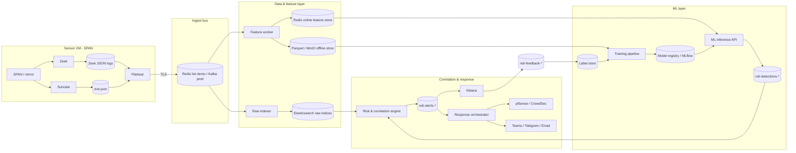
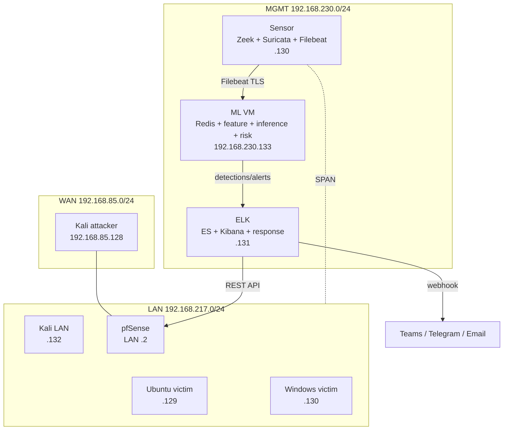
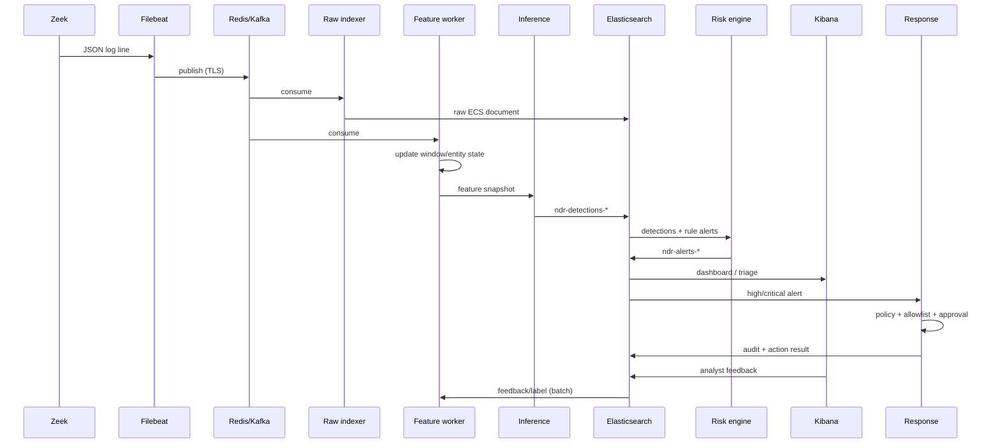

# Thiết kế hệ thống NDR tích hợp AI/ML

> Tài liệu này mô tả thiết kế chi tiết để bổ sung lớp AI/ML vào hệ thống NDR Zeek–ELK hiện có.  
> Cơ sở nghiên cứu: [`01-research-report.md`](./01-research-report.md). Kế hoạch thực hiện: [`03-implementation-plan.md`](./03-implementation-plan.md).

---

## 1. Mục tiêu, phạm vi, nguyên tắc

### 1.1 Mục tiêu

1. Bổ sung khả năng phát hiện hành vi không chữ ký và biến thể tấn công cho 6 kịch bản của đồ án.
2. Giảm alert fatigue bằng cách gộp rule alert, ML detection, threat intel và ngữ cảnh tài sản thành một hàng đợi cảnh báo có ưu tiên.
3. Giữ nguyên khả năng hiện có: visibility, signature detection, MITRE mapping, response automation.
4. Tạo nền tảng có thể mở rộng lên production: streaming, replay, model versioning, drift monitoring.
5. Đảm bảo mọi alert có thể giải thích và truy vết về log gốc (`uid`, `community_id`, 5-tuple).

### 1.2 Phạm vi

- Trong phạm vi: pipeline ingest, feature engineering, model inference, risk fusion, alert schema, dashboard, response integration, MLOps tối thiểu, đánh giá.
- Ngoài phạm vi giai đoạn đầu: giải mã TLS, phân tích payload, EDR, identity logs, cloud logs, tự động remediation phức tạp.
- Môi trường: lab của đồ án; thiết kế có tính đến production nhưng không yêu cầu triển khai production ngay.

### 1.3 Nguyên tắc thiết kế

| Nguyên tắc | Diễn giải |
|---|---|
| **Rule-first, ML-augmented** | Rule/signature vẫn là lớp 0; ML không thay thế |
| **Out-of-band** | Không chạy model nặng trên sensor; không ảnh hưởng packet capture |
| **Metadata-only** | Chỉ dùng log metadata; không thu payload/nội dung |
| **Explainable** | Alert phải có score, threshold, top features/reason codes |
| **Replayable** | Mọi quyết định có thể tái tạo từ log + model version |
| **Versioned** | Model, feature set, threshold, schema đều có version |
| **Fail-open for detection, fail-safe for response** | ML lỗi thì rule vẫn chạy; auto-block phải có guardrail |
| **Human-in-the-loop** | Auto-block chỉ với critical + confidence cao + policy; LLM không tự chặn |
| **Measure before/after** | Có baseline rule-only trước khi thêm ML |

---

## 2. Kiến trúc tổng thể

### 2.1 Kiến trúc logic



### 2.2 Kiến trúc triển khai trong lab



**Ghi chú:**

- ML VM nằm trong vùng MGMT, không lộ với attacker trong LAN.
- Nếu không đủ tài nguyên, có thể chạy ML service trên ELK VM với Docker resource limit, nhưng không khuyến nghị cho production.
- Sensor chỉ chịu trách nhiệm thu thập và gửi log; không chạy model.

### 2.3 Các phương án tích hợp và quyết định

| Phương án | Mô tả | Ưu điểm | Nhược điểm | Quyết định |
|---|---|---|---|---|
| A. On-sensor sidecar | Python đọc log trên sensor, chạy model tại chỗ | Latency thấp, ít VM | Tranh CPU/RAM với Zeek, khó update, single point, rủi ro capture | Chỉ dùng cho feature nhẹ; không chạy model |
| B. Out-of-band bus + ML VM | Filebeat → Redis/Kafka → feature/inference → ES | Cô lập, replay, scale, update độc lập | Thêm thành phần, latency | **Khuyến nghị** |
| C. Batch/offline only | Định kỳ đọc log từ ES/Parquet, chấm điểm | Đơn giản, rẻ | Không real-time, không response | Bổ sung cho training/hunting |
| D. Direct ES polling | ML service poll index ES | Không thêm bus | Tải ES, latency, khó stateful window | Chỉ dùng cho prototype nhỏ |

**Quyết định:** dùng **B** cho real-time; dùng **C** cho training/evaluation/hunting. Có thể bắt đầu bằng D trong 1–2 ngày để kiểm chứng nhanh, nhưng không đưa vào thiết kế cuối.

### 2.4 Thành phần chi tiết

| Thành phần | Trách nhiệm | Công nghệ gợi ý | Ghi chú |
|---|---|---|---|
| `zeek` | Sinh log JSON | Zeek + `json-logs.zeek` + JA3/JA4 | Bật `uid`, `community_id`, `capture_loss` |
| `suricata` | Signature detection | Suricata | Giữ nguyên |
| `filebeat` | Tail log, gửi bus | Filebeat | TLS, spool, fields metadata |
| `bus` | Buffer/replay | Redis list (demo), Kafka (prod) | Competing consumer, retention; Filebeat không ghi trực tiếp Redis Streams |
| `raw-indexer` | Ghi raw ECS vào ES | Python/Logstash/Kafka Connect | Bulk, retry, DLQ |
| `feature-worker` | Tính feature cửa sổ | Python + Redis state | Stateful, watermark, versioned features |
| `online-store` | Feature online | Redis | TTL, hash, version prefix |
| `offline-store` | Feature offline | Parquet + MinIO/S3 | Partition theo ngày/giờ |
| `inference-api` | Chạy model, ghi detection | FastAPI + ONNX/sklearn/XGBoost | Batch, healthcheck, metrics |
| `risk-engine` | Dedup/correlation/risk | Python | Đọc detection + rule alert |
| `alert-store` | Lưu alert | Elasticsearch | ECS + custom fields |
| `kibana` | Dashboard, triage, feedback | Kibana | Saved objects as code |
| `response` | Chặn/thông báo | Python | Guardrail, allowlist, audit |
| `label-store` | Nhãn/feedback | Parquet/ES | Versioned |
| `training` | Train/evaluate/register | Python + MLflow | Offline, reproducible |
| `registry` | Model artifacts | MLflow / file registry | Stage, signature, metrics |
| `llm-triage` | Tóm tắt/giải thích | LLM + RAG | Optional, async, human review |

---

## 3. Luồng dữ liệu và xử lý

### 3.1 Luồng end-to-end



> **Fan-out trong demo:** Filebeat chỉ ghi được Redis list, không ghi trực tiếp Redis Streams và không fan-out cho nhiều consumer độc lập. Vì vậy `raw-indexer` đóng vai trò router: consume `zeek:raw`, ghi raw vào Elasticsearch, rồi `LPUSH` bản sao vào list `zeek:features` cho `feature-worker`. Production dùng Kafka consumer group để fan-out trực tiếp, không cần bước trung gian.

### 3.2 Latency budget

| Chặng | Mục tiêu | Ghi chú |
|---|---|---|
| Zeek ghi log | 1–5 s | Phụ thuộc rotation/flush |
| Filebeat harvest | 1–2 s | `scan_frequency`, `close_inactive` |
| Bus | < 100 ms | Redis/Kafka nội bộ |
| Feature window | 0–5 s | Tùy window; emit interim cho window dài |
| Inference | < 100 ms p95 | Batch nhỏ, model nhẹ |
| ES index | 1–2 s | Bulk + refresh interval |
| Risk/correlation | < 1 s | In-memory/stream |
| Notification | < 5 s | Webhook/API |
| **Tổng (alert tức thời)** | **< 15–60 s** | Đạt yêu cầu < 1 phút |
| **Beaconing xác nhận** | **5–15 phút** | Cần đủ mẫu chu kỳ; có alert nghi ngờ sớm |

**Quan trọng:** yêu cầu "< 1 phút" của đồ án nên hiểu là **từ lúc hành vi đủ bằng chứng đến khi có thông báo**. Với beaconing/DNS tunneling, cần nhiều sự kiện mới kết luận; thiết kế hai mức alert:

- `suspicion` sớm khi có 4–5 kết nối bất thường (trong vòng 1 phút).
- `confirmed` sau 8–10 kết nối hoặc 5–15 phút.

### 3.3 Luồng theo kịch bản

| Kịch bản | Log chính | Feature window | Detector | Output |
|---|---|---|---|---|
| Port scan | `conn.log` | 1 phút / 5 phút | Rule + D2 | Scan probability + fan-out |
| Brute force | `ssh.log`, `ftp.log`, `conn.log` | 5 phút | Rule + D3 | Brute force probability |
| Malware download | `http.log`, `files.log`, `ssl.log`, `intel.log` | Per transaction + 5 phút host context | D4 | Malicious download probability |
| C2 beaconing | `conn.log`, `ssl.log` | 10–15 phút | D5 | Beacon probability + periodicity |
| Lateral movement | `smb_mapping.log`, `smb_files.log`, `dce_rpc.log` | 10 phút | D6 | Lateral movement probability |
| DNS tunneling | `dns.log` | 5 phút | D7 | Tunnel probability + lexical score |

---

## 4. Data contract và schema

### 4.1 Chuẩn hóa ECS từ Zeek

| Zeek field | ECS field | Ghi chú |
|---|---|---|
| `ts` | `@timestamp` | Chuyển epoch → ISO8601 |
| `uid` | `zeek.uid` | Giữ nguyên để drill-down |
| `id.orig_h` | `source.ip` | |
| `id.orig_p` | `source.port` | |
| `id.resp_h` | `destination.ip` | |
| `id.resp_p` | `destination.port` | |
| `proto` | `network.transport` | lowercase |
| `service` | `network.protocol` | |
| `duration` | `event.duration` | ECS dùng nanoseconds; đổi từ giây |
| `orig_bytes` | `source.bytes` | |
| `resp_bytes` | `destination.bytes` | |
| `orig_pkts` | `source.packets` | |
| `resp_pkts` | `destination.packets` | |
| `conn_state` | `zeek.conn_state` | Custom field |
| `community_id` | `network.community_id` | Nếu có; nếu không, tính từ 5-tuple |
| `query` | `dns.question.name` | |
| `qtype_name` | `dns.question.type` | |
| `rcode_name` | `dns.response_code` | |
| `answers` | `dns.answers` | |
| `method` | `http.request.method` | |
| `host` | `url.domain` | |
| `uri` | `url.path` | |
| `status_code` | `http.response.status_code` | |
| `user_agent` | `user_agent.original` | |
| `mime_type` | `file.mime_type` | |
| `filename` | `file.name` | |
| `sha256` | `file.hash.sha256` | |
| `server_name` | `tls.client.server_name` | SNI |
| `ja3` / `ja3s` | `tls.client.ja3` / `tls.server.ja3s` | Cần load JA3 script |
| `ja4` / `ja4s` | `tls.client.ja4` / `tls.server.ja4s` | Custom; cần package JA4 |
| `auth_attempts` | `zeek.ssh.auth_attempts` | |
| `auth_success` | `zeek.ssh.auth_success` | |
| `share` | `zeek.smb.share` | |
| `name` (smb_files) | `file.name` | |
| `action` (smb_files) | `event.action` | read/write |

**Lưu ý:** tên log TLS tùy phiên bản/package (`ssl.log` mặc định; một số bản dùng `tls.log`). Cần kiểm tra log directory thực tế và cấu hình Filebeat tương ứng.

### 4.2 Feature snapshot

```json
{
  "snapshot_id": "fs-20261001T100500Z-0001",
  "schema_version": "1.0",
  "feature_set_version": "v1.3",
  "window": {
    "start": "2026-10-01T10:00:00Z",
    "end": "2026-10-01T10:05:00Z",
    "size_sec": 300,
    "type": "sliding"
  },
  "entity": {
    "type": "host_pair",
    "src_ip": "192.168.217.129",
    "dst_ip": "203.0.113.10",
    "dst_port": 443,
    "proto": "tcp",
    "service": "ssl"
  },
  "features": {
    "conn_count": 12,
    "interval_mean": 30.1,
    "interval_std": 2.4,
    "interval_cv": 0.08,
    "fft_peak_ratio": 0.76,
    "same_size_ratio": 0.92,
    "bytes_ratio": 1.03,
    "ja4_rarity": 4.2,
    "dst_rarity": 5.1
  },
  "context": {
    "community_ids": ["1:abc..."],
    "uids": ["C1..."],
    "ja4": "t13d1516h2_...",
    "sni": "update.example.com"
  },
  "label": null
}
```

### 4.3 Detection event

```json
{
  "@timestamp": "2026-10-01T10:05:12.345Z",
  "event": {
    "kind": "alert",
    "category": ["network", "intrusion_detection"],
    "module": "ndr-ml",
    "severity": 78,
    "action": "detected",
    "dataset": "ndr.detections"
  },
  "rule": {
    "id": "NDR-ML-BEACON-001",
    "name": "ML C2 Beaconing",
    "version": "1.2.0"
  },
  "ml": {
    "model": {
      "name": "beaconing_xgb",
      "version": "1.2.0",
      "type": "classification"
    },
    "score": 0.93,
    "threshold": 0.80,
    "calibrated": true,
    "top_features": [
      {"name": "interval_cv", "value": 0.08, "shap": 0.21},
      {"name": "fft_peak_ratio", "value": 0.76, "shap": 0.18},
      {"name": "ja4_rarity", "value": 4.2, "shap": 0.12}
    ]
  },
  "network": {
    "community_id": "1:abc...",
    "transport": "tcp",
    "protocol": "tls"
  },
  "source": {"ip": "192.168.217.129", "port": 51544},
  "destination": {"ip": "203.0.113.10", "port": 443},
  "zeek": {"uid": "C1..."},
  "mitre": {
    "tactic": ["TA0011"],
    "technique": ["T1071.001", "T1573"]
  },
  "risk": {
    "score": 86,
    "level": "high",
    "reasons": ["ml_beacon_high", "rare_destination", "rare_ja4"]
  },
  "related": {"uids": ["C1..."], "alert_ids": []}
}
```

### 4.4 Alert event

Alert là kết quả của risk engine, có thể gộp nhiều detection/rule:

```json
{
  "@timestamp": "2026-10-01T10:05:13Z",
  "event": {
    "kind": "alert",
    "category": ["network", "intrusion_detection"],
    "module": "ndr-risk",
    "severity": 86,
    "action": "escalated",
    "dataset": "ndr.alerts"
  },
  "alert": {
    "id": "alrt-20261001-0007",
    "status": "open",
    "first_seen": "2026-10-01T10:05:12Z",
    "last_seen": "2026-10-01T10:15:00Z",
    "count": 12
  },
  "risk": {
    "score": 86,
    "level": "high",
    "reasons": ["rule_high", "ml_beacon_high", "intel_match"]
  },
  "mitre": {
    "tactic": ["TA0011"],
    "technique": ["T1071.001", "T1573"]
  },
  "entities": {
    "src_ip": "192.168.217.129",
    "dst_ip": "203.0.113.10",
    "dst_port": 443,
    "host": "ubuntu-victim"
  },
  "evidence": {
    "detections": ["det-..."],
    "rule_alerts": ["suricata-..."],
    "uids": ["C1..."],
    "community_ids": ["1:abc..."]
  },
  "response": {
    "recommended": "isolate_host_manual",
    "auto_action": null,
    "approval_required": true
  },
  "ai": {
    "summary": null,
    "model": null
  }
}
```

### 4.5 Feedback event

```json
{
  "@timestamp": "2026-10-01T11:00:00Z",
  "event": {"kind": "event", "category": ["analysis"], "module": "ndr-feedback"},
  "alert_id": "alrt-20261001-0007",
  "analyst": "analyst1",
  "disposition": "true_positive",
  "reason": "confirmed C2 beacon to known malicious IP",
  "actions": ["blocked", "isolated"],
  "notes": "JA4 matches Cobalt Strike profile",
  "label": {
    "binary": 1,
    "attack_type": "command_and_control",
    "mitre_tactic": ["TA0011"],
    "mitre_technique": ["T1071.001"]
  }
}
```

### 4.6 Model metadata

```json
{
  "model_name": "beaconing_xgb",
  "version": "1.2.0",
  "created_at": "2026-10-01T09:00:00Z",
  "stage": "production",
  "training_data": {
    "dataset": "lab-v3",
    "rows": 120000,
    "positive": 3200,
    "split": "time_based"
  },
  "feature_set_version": "v1.3",
  "features": ["conn_count", "interval_cv", "fft_peak_ratio", "ja4_rarity"],
  "metrics": {
    "pr_auc": 0.91,
    "recall_at_fpr_1pct": 0.87,
    "precision": 0.88,
    "brier": 0.06
  },
  "threshold": 0.8,
  "owner": "team-ndr"
}
```

### 4.7 Index và ILM

| Index | Nội dung | Retention gợi ý |
|---|---|---|
| `zeek-conn-*`, `zeek-dns-*`, `zeek-http-*`, `zeek-ssl-*`, `zeek-files-*`, `zeek-ssh-*`, `zeek-smb-*` | Raw ECS | Hot 7–30 ngày, warm 1–3 tháng, cold 3–12 tháng |
| `suricata-*` | Signature alert | Như trên |
| `ndr-features-*` | Feature snapshot (sampling) | 7–30 ngày |
| `ndr-detections-*` | ML detection | 3–12 tháng |
| `ndr-alerts-*` | Alert đã correlate | 12 tháng |
| `ndr-feedback-*` | Analyst feedback | 12 tháng+ |
| `ndr-models-*` | Model metadata/metrics | 12 tháng+ |
| `ndr-audit-*` | Response/LLM audit | 12 tháng+ |

**Mapping:** dùng index template tĩnh, tránh dynamic mapping; `keyword` cho IP/domain/hash/uid; `float` cho score; `nested` cho `ml.top_features`; `date` cho timestamp.

---

## 5. Feature engineering

### 5.1 Nguyên tắc

1. **Một feature set dùng chung** cho online và offline; code là một package Python.
2. **Feature theo cửa sổ** thay vì chỉ một flow; hành vi tấn công thường là chuỗi.
3. **Entity profile** (host, host pair, domain) để phát hiện novelty/drift.
4. **Cross-log context** qua `uid`, `community_id`, `fuid`.
5. **Không dùng feature tương lai**; watermark và late data rõ ràng.
6. **Minimum support**: không chấm điểm khi chưa đủ sự kiện; trả `insufficient_data`.
7. **Chuẩn hóa và xử lý missing** thống nhất giữa train/serve.

### 5.2 Feature chung

| Feature | Công thức / nguồn | Window | Ý nghĩa |
|---|---|---|---|
| `conn_count` | count(conn) | 1m/5m | Mức hoạt động |
| `unique_dst_hosts` | nunique(dst_ip) | 1m/5m | Fan-out |
| `unique_dst_ports` | nunique(dst_port) | 1m/5m | Scan |
| `failed_ratio` | count(conn_state ∈ {S0, REJ, RSTO, RSTR}) / total | 1m/5m | Kết nối thất bại |
| `syn_only_ratio` | count(conn_state = S0) / total | 1m/5m | SYN scan |
| `bytes_out` / `bytes_in` | sum(orig_bytes) / sum(resp_bytes) | 5m | Khối lượng |
| `bytes_ratio` | bytes_out / (bytes_in + 1) | 5m | Exfil/beacon asymmetry |
| `bytes_per_pkt` | bytes / packets | 5m | Kích thước payload |
| `duration_mean/std` | mean/std(duration) | 5m | Tính ổn định |
| `port_entropy` | Shannon entropy của dst_port | 1m | Scan/deviation |
| `dst_port_rarity` | `-log(freq(dst_port))` | baseline | Cổng hiếm |
| `host_pair_novelty` | 1 nếu cặp (src,dst) chưa thấy trong baseline | 24h | Kết nối mới |
| `time_of_day` | giờ/ngày | — | Bất thường theo giờ |
| `active_hours_deviation` | z-score so với baseline host | 24h | Hoạt động ngoài giờ |

### 5.3 Feature theo kịch bản

#### 5.3.1 Port scan

| Feature | Công thức | Window |
|---|---|---|
| `scan_unique_ports` | nunique(dst_port) per src | 1m |
| `scan_unique_hosts` | nunique(dst_ip) per src | 1m |
| `scan_failed_ratio` | S0/REJ / total | 1m |
| `scan_syn_ratio` | S0 / total | 1m |
| `scan_port_entropy` | entropy(dst_port distribution) | 1m |
| `scan_rate` | connections / sec | 1m |
| `scan_interval_cv` | std(inter-arrival)/mean | 1m |
| `scan_new_host_ratio` | new dst hosts / total | 5m |
| `scan_service_null_ratio` | service null / total | 1m |

**Nhãn:** scan vs benign (monitoring, backup, discovery). **Khó:** scan chậm/phân tán; dùng cửa sổ dài hơn (15m) và graph fan-out.

#### 5.3.2 Brute force SSH/FTP

| Feature | Công thức | Window |
|---|---|---|
| `auth_fail_count` | sum(auth_attempts - auth_success) | 5m |
| `auth_fail_ratio` | fail / total auth_attempts | 5m |
| `auth_conn_count` | count(ssh/ftp conn) | 5m |
| `auth_unique_dst` | nunique(dst_ip) | 5m |
| `auth_interval_cv` | std/mean inter-arrival | 5m |
| `auth_bytes_per_attempt` | bytes / attempts | 5m |
| `ssh_client_banner_rarity` | `-log(freq(client))` | baseline |
| `ftp_530_ratio` | count(reply 530) / total | 5m |
| `auth_success_after_fail` | 1 nếu success sau nhiều fail | 5m |

**Nhãn:** brute force vs admin script. **Khó:** low-and-slow, distributed; dùng entity profile và graph.

#### 5.3.3 Malware download

| Feature | Công thức | Window |
|---|---|---|
| `http_method` | one-hot | per transaction |
| `http_status` | status_code | per transaction |
| `uri_length` | len(uri) | per transaction |
| `uri_entropy` | entropy(uri) | per transaction |
| `host_rarity` | `-log(freq(host))` | baseline |
| `user_agent_rarity` | `-log(freq(user_agent))` | baseline |
| `resp_body_len` | response_body_len | per transaction |
| `mime_rarity` | `-log(freq(mime))` | baseline |
| `file_size` | seen_bytes/total_bytes | per file |
| `file_ext` | extension one-hot | per file |
| `executable_flag` | 1 nếu .exe/.dll/.ps1/.bat | per file |
| `hash_intel_match` | 1 nếu hash trong IOC | per file |
| `domain_intel_match` | 1 nếu domain trong IOC | per transaction |
| `ja3_rarity` / `ja4_rarity` | rarity fingerprint | baseline |
| `sni_rarity` | rarity SNI | baseline |
| `content_type_mismatch` | extension vs MIME mismatch | per file |
| `download_source_rarity` | rarity source IP/domain | baseline |
| `first_seen_file` | hash chưa thấy trong 30 ngày | 30d |

**Nhãn:** malicious vs benign download. **Khó:** malware chưa biết, HTTPS; dùng behavior + TLS fingerprint.

#### 5.3.4 C2 beaconing

| Feature | Công thức | Window |
|---|---|---|
| `beacon_count` | count(conn) per pair | 10–15m |
| `interval_mean` | mean(delta t) | 10–15m |
| `interval_std` | std(delta t) | 10–15m |
| `interval_cv` | std/mean | 10–15m |
| `interval_median` | median(delta t) | 10–15m |
| `interval_mad` | MAD(delta t) | 10–15m |
| `interval_min/max` | min/max | 10–15m |
| `autocorr_lag1` | autocorrelation lag 1 | 10–15m |
| `fft_peak_ratio` | max spectral power / total (exclude DC) | 10–15m |
| `fft_entropy` | entropy của phổ | 10–15m |
| `same_size_ratio` | tỷ lệ gói cùng kích thước | 10–15m |
| `bytes_cv` | std/mean bytes | 10–15m |
| `duration_cv` | std/mean duration | 10–15m |
| `unique_sni` | nunique SNI | 10–15m |
| `ja4_rarity` | rarity JA4 | baseline |
| `dst_rarity` | rarity destination | baseline |
| `periodicity_score` | kết hợp FFT + autocorr + CV | 10–15m |

**Nhãn:** beacon vs benign periodic (NTP, update, telemetry, AV). **Khó:** jitter, multi-channel; dùng ensemble + destination rarity + allowlist.

#### 5.3.5 Lateral movement SMB/PsExec

| Feature | Công thức | Window |
|---|---|---|
| `smb_unique_dsts` | nunique(dst_ip) per src | 10m |
| `smb_admin_share_count` | count(share ∈ {ADMIN$, C$}) | 10m |
| `smb_exe_write_count` | count(action=write, ext=.exe/.dll) | 10m |
| `smb_mapping_rarity` | rarity(share/path) | baseline |
| `dce_rpc_svcctl_count` | count(operation=svcctl) | 10m |
| `dce_rpc_atsvc_count` | count(operation=atsvc) | 10m |
| `service_creation_count` | count(service create) | 10m |
| `smb_write_to_service_delta` | time từ write .exe đến svcctl | 10m |
| `new_host_pair_count` | new (src,dst) SMB pairs | 10m |
| `graph_out_degree` | số đích SMB khác nhau | 10m |
| `graph_new_edges` | số cạnh mới | 10m |
| `graph_betweenness` | betweenness approximation | 10m |
| `asset_criticality` | trọng số tài sản | — |

**Nhãn:** lateral movement vs IT admin/backup. **Khó:** biến thể, credential-based; dùng graph + sequence.

#### 5.3.6 DNS tunneling

| Feature | Công thức | Window |
|---|---|---|
| `dns_query_count` | count(query) per (src,parent_domain) | 5m |
| `dns_unique_subdomains` | nunique(subdomain) | 5m |
| `dns_query_len_mean/max` | len(query) | 5m |
| `dns_label_count_mean/max` | số label | 5m |
| `dns_first_label_len` | len(first label) | 5m |
| `dns_entropy_mean/max` | Shannon entropy | 5m |
| `dns_unique_char_ratio` | unique chars / len | 5m |
| `dns_digit_ratio` | digits / len | 5m |
| `dns_vowel_ratio` | vowels / len | 5m |
| `dns_consonant_ratio` | consonants / len | 5m |
| `dns_txt_ratio` | qtype TXT / total | 5m |
| `dns_null_ratio` | qtype NULL / total | 5m |
| `dns_nxdomain_ratio` | rcode NXDOMAIN / total | 5m |
| `dns_answer_count_mean` | answers / query | 5m |
| `dns_ttl_mean` | TTL | 5m |
| `dns_query_rate` | queries/sec | 5m |
| `dns_interval_cv` | std/mean inter-arrival | 5m |
| `dns_parent_rarity` | rarity parent domain | baseline |
| `dns_subdomain_rarity` | rarity subdomain | baseline |
| `dga_like_score` | lexical heuristic | per query |
| `tunnel_score` | kết hợp entropy + length + rate | 5m |
| `is_mdns`, `is_local_tld`, `is_reverse_lookup` | flag | — |

**Nhãn:** tunnel vs benign (CDN, AV, telemetry). **Khó:** low-entropy, DoH; downweight mDNS/local/reverse lookup.

### 5.4 Window và state

| Detector | Window | Min events | Emit |
|---|---|---|---|
| Scan | 1m tumbling + 5m sliding | 20 conn | Mỗi 30s |
| Brute force | 5m sliding | 10 auth | Mỗi 30s |
| Malware | Per transaction | 1 file | Ngay |
| Beaconing | 10–15m sliding | 6–8 conn | Mỗi 60s + khi đủ mẫu |
| Lateral movement | 10m sliding/session | 3 SMB events | Mỗi 30s |
| DNS tunneling | 5m sliding | 10 queries | Mỗi 30s |
| Anomaly | 1m/5m | 1 record | Ngay/theo batch |

**Watermark:** cho phép trễ 30s; nếu event đến muộn, cập nhật state và phát lại snapshot hiệu chỉnh (idempotent theo `snapshot_id`).

### 5.5 Feature store

- **Online:** Redis hash `feat:{version}:{entity_type}:{key}:{window}`; TTL = 2 × window; value JSON; cập nhật nguyên tử bằng Lua script nếu cần.
- **Offline:** Parquet, partition `date=YYYY-MM-DD/hour=HH/`, schema registry.
- **Feature registry:** YAML/Python mô tả tên, kiểu, nguồn, window, owner, version, mô tả.
- **Sampling:** lưu snapshot đã chấm điểm và một tỷ lệ snapshot bình thường để tái huấn luyện/audit.
- **Backfill:** replay từ raw Parquet để tạo feature offline; cùng code với online.

### 5.6 Train/serve parity

- Một package `ndr_features` dùng chung.
- Unit test cho entropy, window, missing value, edge case (1 event, 0 duration, IPv6).
- Golden test: raw log cố định → feature snapshot cố định.
- Schema validation bằng Pydantic/Pandera.
- Model metadata ghi `feature_set_version`; inference từ chối nếu mismatch.

---

## 6. Thiết kế model

### 6.1 Các lớp phát hiện

| Lớp | Tên | Vai trò | Output |
|---|---|---|---|
| 0 | Rule/signature | Precision cao, hành vi đã biết | Alert |
| 1 | D1 anomaly | Bất thường chưa biết | Score 0–1 |
| 2 | D2–D7 | Phân loại họ tấn công | Probability + class |
| 3 | D8 risk fusion | Gộp tín hiệu, ưu tiên | Risk 0–100 |
| 4 | D9 LLM triage | Giải thích, gợi ý | Summary/actions |

### 6.2 D1 — Anomaly detection

| Mục | Nội dung |
|---|---|
| Mục tiêu | Phát hiện flow/hành vi lệch baseline bình thường |
| Input | `conn.log`, `dns.log`, `ssl.log`, `http.log`, `ssh.log` |
| Feature | Flow features + entity/window features + rarity |
| Algorithm | Isolation Forest (batch); KitNET/PySAD (online); autoencoder (mở rộng) |
| Training | Chỉ benign baseline; time split; robust scaler |
| Output | Anomaly score chuẩn hóa 0–1; top features |
| Threshold | Percentile 99 của benign; alert nếu vượt + context |
| Giải thích | Feature deviation, percentile, lý do |
| Hạn chế | Nhiễu, drift, encrypted; không phải verdict |
| Metric | FP/ngày, recall trên attack, top-k precision |

**Chiến lược:** dùng anomaly score như một tín hiệu trong risk fusion, không tự động chặn. Với mỗi log type, có thể dùng detector riêng (theo bài học Stratosphere).

### 6.3 D2 — Port scan

| Mục | Nội dung |
|---|---|
| Mục tiêu | Phát hiện scan nhanh/chậm/phân tán |
| Input | `conn.log` |
| Feature | Scan features (mục 5.3.1) |
| Algorithm | LightGBM/XGBoost; fallback Isolation Forest nếu thiếu label |
| Training | Label từ kịch bản + benign monitoring |
| Output | Scan probability; fan-out score |
| Threshold | 0.7; rule high-rate vẫn giữ |
| Giải thích | Top ports/hosts, failed ratio |
| Hạn chế | Monitoring/backup giống scan; cần allowlist |
| Metric | Recall slow scan, FP/ngày |

### 6.4 D3 — Brute force

| Mục | Nội dung |
|---|---|
| Mục tiêu | Phát hiện brute force/credential stuffing, kể cả low-and-slow |
| Input | `ssh.log`, `ftp.log`, `conn.log` |
| Feature | Auth features (mục 5.3.2) |
| Algorithm | LightGBM; rule cho high-rate |
| Training | Label từ hydra + benign admin |
| Output | Brute force probability |
| Threshold | 0.75; rule high-rate vẫn giữ |
| Giải thích | Auth fail count/ratio, interval |
| Hạn chế | Distributed, password spray; cần graph |
| Metric | Recall low-and-slow, FP từ admin script |

### 6.5 D4 — Malware download

| Mục | Nội dung |
|---|---|
| Mục tiêu | Phát hiện tải malware, kể cả hash chưa biết |
| Input | `http.log`, `files.log`, `ssl.log`, `intel.log` |
| Feature | HTTP/file/TLS features (mục 5.3.3) |
| Algorithm | XGBoost/LightGBM; calibration isotonic/Platt |
| Training | Lab malware + benign downloads; pretrain public |
| Output | Malicious download probability |
| Threshold | 0.8; intel match tăng risk, không thay model |
| Giải thích | SHAP top features, hash/domain intel |
| Hạn chế | HTTPS, file lớn, false positive từ software update |
| Metric | PR-AUC, recall unknown malware, FP |

### 6.6 D5 — C2 beaconing

| Mục | Nội dung |
|---|---|
| Mục tiêu | Phát hiện beacon đều/jitter/multi-channel |
| Input | `conn.log`, `ssl.log` |
| Feature | Beacon features (mục 5.3.4) |
| Algorithm | LightGBM + Isolation Forest ensemble; score = 0.7×supervised + 0.3×anomaly |
| Training | Beacon simulator (đều/jitter) + benign periodic |
| Output | Beacon probability + periodicity score |
| Threshold | 0.8; hai mức suspicion/confirmed |
| Giải thích | Interval CV, FFT peak, JA4/SNI rarity |
| Hạn chế | Benign periodic (NTP/update/AV); jitter cao; domain fronting |
| Metric | Recall jitter, FP/ngày, MTTD |

**Điểm quan trọng:** beaconing là use case có giá trị ML cao nhất, nhưng cũng dễ false positive nhất. Cần:
- Minimum 6–8 connections.
- So sánh với baseline periodic của chính host.
- Allowlist cho update/telemetry.
- Kết hợp destination rarity và JA4/SNI.

### 6.7 D6 — Lateral movement

| Mục | Nội dung |
|---|---|
| Mục tiêu | Phát hiện di chuyển ngang qua SMB/DCE-RPC |
| Input | `smb_mapping.log`, `smb_files.log`, `dce_rpc.log`, `conn.log` |
| Feature | SMB/graph features (mục 5.3.5) |
| Algorithm | LightGBM trên graph/sequence; GraphSAGE mở rộng |
| Training | PsExec/impacket + benign admin/backup |
| Output | Lateral movement probability |
| Threshold | 0.8; rule sequence vẫn giữ |
| Giải thích | Share, file write, svcctl, graph fan-out |
| Hạn chế | IT admin, backup, software deployment |
| Metric | Recall variants, FP từ admin |

### 6.8 D7 — DNS tunneling

| Mục | Nội dung |
|---|---|
| Mục tiêu | Phát hiện exfil qua DNS, kể cả low-entropy |
| Input | `dns.log` |
| Feature | DNS features (mục 5.3.6) |
| Algorithm | LightGBM + lexical score; CNN/char-level mở rộng |
| Training | iodine/dnscat2 + benign DNS |
| Output | Tunnel probability + lexical score |
| Threshold | 0.8; kết hợp query rate + unique subdomains |
| Giải thích | Entropy, length, query rate, parent rarity |
| Hạn chế | DoH, domain fronting, low-and-slow |
| Metric | Recall variants, FP từ CDN/AV |

### 6.9 D8 — Risk fusion

| Mục | Nội dung |
|---|---|
| Mục tiêu | Gộp rule, ML, intel, asset thành risk thống nhất |
| Input | Rule alerts, detection scores, intel, asset, feedback |
| Algorithm | Scorecard minh bạch; logistic regression khi đủ feedback |
| Output | Risk 0–100 + level + reasons |
| Công thức | Xem mục 7.2 |
| Threshold | Critical ≥85, high 70–84, medium 40–69, low <40 |
| Giải thích | Reasons list, top contributing detections |
| Hạn chế | Trọng số cần hiệu chỉnh; feedback bias |

### 6.10 D9 — LLM triage (optional)

| Mục | Nội dung |
|---|---|
| Mục tiêu | Tóm tắt alert, giải thích bằng chứng, gợi ý bước tiếp theo |
| Input | Alert + related raw events + asset + playbook + similar alerts |
| Model | LLM API/local + RAG |
| Output | JSON: summary, evidence, hypotheses, MITRE, actions, confidence, caveats |
| Guardrail | Retrieval allowlist, no tool execution, no auto-block, redaction, output validation, audit |
| Evaluation | Factual consistency, helpfulness, MITRE accuracy, hallucination rate |
| Hạn chế | Hallucination, prompt injection, chi phí, latency |
| Quyết định | Chỉ dùng cho high/critical, async, human review |

### 6.11 Bảng model card tóm tắt

| ID | Model | Loại | Label | Output | Metric chính | Ưu tiên |
|---|---|---|---|---|---|---|
| D1 | `anomaly_iforest` / `kitnet` | Unsupervised | Không | Score 0–1 | FP/ngày, recall | P1 |
| D2 | `scan_lgbm` | Supervised | Ít | Probability | Recall slow scan | P2 |
| D3 | `bruteforce_lgbm` | Supervised | Ít | Probability | Recall low-and-slow | P2 |
| D4 | `malware_xgb` | Supervised | Trung bình | Probability | PR-AUC | P2 |
| D5 | `beaconing_xgb_if` | Hybrid | Cao | Probability + periodicity | Recall jitter, FP | P1 |
| D6 | `lateral_lgbm` | Supervised | Trung bình | Probability | Recall variants | P2 |
| D7 | `dns_tunnel_lgbm` | Supervised | Cao | Probability + lexical | Recall variants | P1 |
| D8 | `risk_scorecard` | Scorecard | Feedback | Risk 0–100 | Alert precision | P3 |
| D9 | `llm_triage` | LLM+RAG | Không | Summary/actions | Human rating | P3 |

### 6.12 Calibration và threshold

- Calibrate xác suất trên validation set (isotonic/Platt) trước khi dùng trong risk fusion.
- Chọn threshold theo ràng buộc vận hành: `FP/ngày ≤ X` hoặc `precision ≥ Y`, không chỉ maximize F1.
- Lưu threshold trong model metadata; không hardcode trong code.
- Đánh giá lại threshold sau mỗi lần retrain/drift.
- Với scorecard, dùng trọng số cố định có thể giải thích; logistic regression cần đủ feedback và kiểm tra hệ số.

---

## 7. Correlation, scoring và MITRE mapping

### 7.1 Vòng đời alert

1. **Detection:** rule/ML tạo detection với score, threshold, evidence.
2. **Normalize:** chuẩn hóa về ECS + custom fields.
3. **Dedup:** cùng `uid`/`community_id`/entity/technique trong cửa sổ.
4. **Correlate:** gộp detection cùng nguồn/đích/chiến dịch; tính kill-chain stage.
5. **Enrich:** asset criticality, threat intel, JA4/SNI, related events.
6. **Risk:** tính risk score/level/reasons.
7. **Triage:** LLM optional; analyst review.
8. **Respond:** auto/manual theo policy.
9. **Feedback:** disposition → label store.
10. **Learn:** retraining/drift.

### 7.2 Risk formula (scorecard)

```text
base = max(
  rule_severity,                    # 0-100
  100 * max(ml_probabilities),      # 0-100
  100 * anomaly_score               # 0-100
)

risk = base
     + 10 nếu intel_match
     + 10 nếu asset_critical
     + 10 nếu detectors_agree >= 2
     + 5  nếu kill_chain_advance
     - 10 nếu allowlisted
     - 10 nếu historical_fp_rate > 0.5

risk = clamp(risk, 0, 100)
```

Trong implementation, thành phần không có (ví dụ không có ML score) được thay bằng 0; `detectors_agree` đếm số detector độc lập có score ≥ threshold. Risk score là điểm ưu tiên, không phải xác suất tấn công.

**Level:**

| Risk | Level | Hành động |
|---|---|---|
| ≥ 85 | Critical | Auto-block nếu policy cho phép; notify ngay |
| 70–84 | High | Notify + đề xuất block; analyst approval |
| 40–69 | Medium | Vào queue; điều tra |
| < 40 | Low | Log/hunting; không alert |

**Lưu ý:** trọng số là khởi điểm; cần hiệu chỉnh bằng feedback. Có thể thay bằng logistic regression khi có đủ label, nhưng phải giữ reason codes.

### 7.3 Dedup và correlation

- **Dedup theo `uid`:** cùng một flow có nhiều detection → gộp.
- **Dedup theo `community_id`:** ghép Suricata + Zeek cùng flow.
- **Dedup theo entity + technique:** cùng src/dst + MITRE technique trong 30 phút → gộp, tăng count.
- **Correlation theo kill chain:** scan → brute force → malware download → C2 → lateral movement → exfil; nếu cùng src/host, tăng risk.
- **Time decay:** alert cũ giảm trọng số; tránh queue tồn đọng.
- **Suppression:** maintenance window, allowlist, known benign periodic.

### 7.4 MITRE mapping

| # | Kịch bản | Detection | Tactic | Technique | Response |
|---|---|---|---|---|---|
| 1 | Port scan | D2 + rule | TA0007 Discovery | T1046 | Alert |
| 2 | Brute force SSH/FTP | D3 + rule | TA0006 Credential Access | T1110 | Block IP + notify |
| 3 | Malware download | D4 + intel/Suricata | TA0011 Command and Control | T1105 | Block source + notify |
| 4 | C2 beaconing | D5 | TA0011 | T1071.001, T1573 | Alert + isolate host (manual) |
| 5 | Lateral movement SMB | D6 + rule | TA0008 Lateral Movement; TA0002 Execution | T1021.002; T1569.002 | Block internal IP + notify |
| 6 | DNS exfiltration | D7 | TA0010 Exfiltration; TA0011 | T1048; T1071.004 | Block IP + notify |

**Mapping rule:** mỗi detection có `mitre.tactic`/`mitre.technique`; risk engine giữ mapping của detection mạnh nhất và bổ sung từ rule. Dashboard thống kê theo tactic/technique.

### 7.5 Severity và response matrix

| Risk | Auto-block | Notify | Approval | Ghi chú |
|---|---|---|---|---|
| Critical + confidence ≥ 0.9 + not allowlisted | Có (TTL 1h) | Có | Không | Audit + rollback |
| Critical + confidence < 0.9 | Không | Có | Có | Analyst xác nhận |
| High | Không | Có | Có | Đề xuất hành động |
| Medium | Không | Không | — | Queue/hunt |
| Low | Không | Không | — | Log |

---

## 8. Tích hợp response và guardrail

### 8.1 Playbook

| Kịch bản | Playbook |
|---|---|
| Port scan | Alert → xác nhận nguồn → (nếu internal) kiểm tra host → block nếu tiếp diễn |
| Brute force | Alert → block IP nguồn → kiểm tra auth success → reset credential nếu cần |
| Malware download | Alert → block source/domain → cách ly host → quét file/hash → báo cáo |
| C2 beaconing | Alert → xác nhận beacon → cách ly host → block destination → hunt lateral |
| Lateral movement | Alert → block internal IP → cách ly host → kiểm tra share/service → hunt |
| DNS tunneling | Alert → block IP/domain → cách ly host → kiểm tra DNS logs → hunt |

#### 8.1.1 Quy trình sự cố 5 bước

Mỗi playbook ở trên được thực hiện theo cùng một quy trình, đáp ứng yêu cầu "phát hiện → phân loại → ngăn chặn → điều tra → báo cáo":

| Bước | Mục tiêu | Hành động chính | Output |
|---|---|---|---|
| 1. Phát hiện | Xác nhận có sự kiện đáng chú ý | Nhận alert từ rule/ML; kiểm tra risk, evidence, `uid`/`community_id`; loại alert trùng/suppress | Alert ID, risk, evidence |
| 2. Phân loại | Xác định loại và mức độ | Map MITRE tactic/technique; xác định TP/FP sơ bộ; xác định tài sản bị ảnh hưởng; chọn playbook | Scenario, severity, owner |
| 3. Ngăn chặn | Giảm thiệt hại | Block IP/domain/host theo policy; cách ly host nếu cần; kiểm tra allowlist; ghi audit | Action + kết quả |
| 4. Điều tra | Tìm nguyên nhân/lateral | Drill-down timeline; xem conn/DNS/HTTP/TLS/SMB; đối chiếu intel/JA4/hash; hunt host liên quan | Bằng chứng, phạm vi ảnh hưởng |
| 5. Báo cáo | Đóng sự cố và cải thiện | Ghi nhận biện pháp, kết quả, bài học; cập nhật playbook/label; đề xuất rule/model | Incident report, feedback |

**Lưu ý:** với alert ML, bước 1 cần ghi rõ model/version/threshold và top features để analyst có thể đánh giá độ tin cậy trước khi hành động.

### 8.2 Guardrail

- **Allowlist:** IP/domain/host của hạ tầng quản trị, backup, monitoring, update.
- **Confidence threshold:** chỉ auto-block khi risk critical + confidence ≥ 0.9 + không allowlist.
- **Time-bound block:** TTL 1h mặc định; tự gỡ; audit.
- **Rate limit:** tránh block hàng loạt do một alert storm.
- **Human approval:** high/medium; có UI trong Kibana hoặc chat.
- **Rollback:** API unblock; log lý do; idempotent.
- **Audit:** mọi action ghi `ndr-audit-*` với alert_id, analyst/system, before/after.
- **Fail-safe:** nếu API firewall lỗi, retry có backoff; không block nếu không xác nhận được.

### 8.3 Tích hợp kỹ thuật

- Response service đọc `ndr-alerts-*` qua ES query (risk ≥ threshold, status open).
- Hoặc consume từ stream nếu cần latency thấp.
- Gọi pfSense/CrowdSec REST API; lưu kết quả vào alert.
- Gửi Teams/Telegram/email với template: risk, scenario, src/dst, MITRE, evidence, recommended action, link Kibana.
- LLM không được gọi trực tiếp response API; chỉ tạo summary/đề xuất.

---

## 9. Triển khai

### 9.1 Topology lab

| VM | Vai trò | Mạng/IP | Thay đổi |
|---|---|---|---|
| Kali | Attacker | WAN .128, LAN .132 | Giữ nguyên; thêm script cho 6 kịch bản |
| pfSense | Gateway/firewall | WAN .87, LAN .2, OPT1 .2 | Giữ nguyên; API block |
| Ubuntu victim | DVWA/SSH/FTP | LAN .129 | Giữ nguyên |
| Windows victim | SMB share | LAN .130 | Giữ nguyên |
| Sensor | Zeek + Suricata + Filebeat | MGMT .130, NIC sniff không IP | Bật JSON, JA3/JA4, Filebeat → ML VM |
| ELK | ES + Kibana + response | MGMT .131 | Thêm index template, dashboard, alert queue |
| ML | Redis + feature + inference + risk | MGMT 192.168.230.133 (đề xuất) | Mới |

### 9.2 Service và port

| Service | Port | Giao thức | Ghi chú |
|---|---|---|---|
| Elasticsearch | 9200 | HTTPS | TLS, API key |
| Kibana | 5601 | HTTPS | RBAC |
| Redis | 6379 | TLS | Auth, internal |
| Inference API | 8000 | HTTP/TLS | Internal, token |
| MLflow | 5000 | HTTPS | Optional |
| MinIO/S3 | 9000 | HTTPS | Optional |
| Prometheus/Grafana | 9090/3000 | HTTPS | Optional |

### 9.3 Resource sizing

**Lab:**

- ML VM: 4 vCPU, 8 GB RAM, 100 GB SSD.
- Redis: 1–2 GB.
- Model artifacts: < 100 MB mỗi model.
- Throughput: 1–10 Mbps, ~1k–10k flow/phút, ~10k–50k EPS.
- Inference: batch 500–2000 flow; p95 < 100 ms.

**Production (định hướng):**

- 1 Gbps → ~100k–500k flow/phút; Kafka 3 broker; Flink/Spark Structured Streaming; inference replicas; ES 3+ node; GPU optional.
- Công thức ước lượng:
  `flows/s ≈ bandwidth_bps / (avg_packet_size_bytes × 8) / avg_packets_per_flow`
- Scale feature worker/inference theo consumer lag; scale ES theo ingest rate.

### 9.4 Docker Compose skeleton

```yaml
version: "3.9"

services:
  redis:
    image: redis:7-alpine
    command: ["redis-server", "--appendonly", "yes", "--requirepass", "${REDIS_PASSWORD}"]
    ports:
      - "6379:6379"
    volumes:
      - redis-data:/data
    healthcheck:
      test: ["CMD", "redis-cli", "-a", "${REDIS_PASSWORD}", "ping"]
      interval: 10s
      timeout: 3s
      retries: 5

  feature-worker:
    build: ./pipelines/features
    environment:
      REDIS_URL: redis://:${REDIS_PASSWORD}@redis:6379/0
      FEATURE_SET_VERSION: v1.3
      LOG_LEVEL: INFO
    depends_on:
      redis:
        condition: service_healthy
    restart: unless-stopped
    deploy:
      resources:
        limits:
          cpus: "2"
          memory: 2G

  inference:
    build: ./serving/inference
    environment:
      REDIS_URL: redis://:${REDIS_PASSWORD}@redis:6379/0
      ES_URL: ${ES_URL}
      ES_API_KEY: ${ES_API_KEY}
      MODEL_DIR: /models
    volumes:
      - ./models:/models:ro
    ports:
      - "8000:8000"
    depends_on:
      redis:
        condition: service_healthy
    healthcheck:
      test: ["CMD", "curl", "-f", "http://localhost:8000/health"]
      interval: 15s
      timeout: 5s
      retries: 5
    restart: unless-stopped

  risk-engine:
    build: ./pipelines/risk
    environment:
      ES_URL: ${ES_URL}
      ES_API_KEY: ${ES_API_KEY}
      RISK_THRESHOLD: "70"
    depends_on:
      - inference
    restart: unless-stopped

  mlflow:
    image: ghcr.io/mlflow/mlflow:latest
    command: ["mlflow", "server", "--host", "0.0.0.0", "--port", "5000"]
    ports:
      - "5000:5000"
    volumes:
      - mlflow-data:/mlflow
    profiles: ["training"]

volumes:
  redis-data:
  mlflow-data:
```

### 9.5 Production evolution

| Thành phần lab | Production |
|---|---|
| Redis list (demo) | Kafka + Schema Registry |
| Python feature worker | Flink/Spark Structured Streaming |
| Redis feature store | Feast/Redis cluster |
| FastAPI + local models | KServe/Triton + model registry |
| File-based registry | MLflow Model Registry |
| Docker Compose | Kubernetes + Helm |
| Local Parquet | S3/MinIO + lakehouse |
| Basic metrics | Prometheus/Grafana + alerting |
| Static secrets | Vault/KMS + mTLS |
| Single ML VM | Multiple replicas + autoscaling |

### 9.6 HA, backpressure, degradation

- **Backpressure:** Redis list dùng `LTRIM`/processing list; Kafka dùng retention + consumer group; monitor lag; ưu tiên giữ raw log hơn feature snapshot.
- **Filebeat:** spool to disk, retry, `bulk_max_size` hợp lý.
- **Inference:** batch có timeout; nếu queue đầy, trả `unavailable` và để risk engine dùng rule.
- **ES:** bulk retry, DLQ; tránh refresh quá thường xuyên.
- **Degradation:**
  - ML service down → rule alerts vẫn hoạt động; dashboard báo “ML degraded”.
  - Redis down → Filebeat buffer; feature worker replay sau.
  - Risk engine down → detection vẫn lưu; alert queue tạm thời chỉ rule.
  - LLM down → không có summary; alert vẫn đầy đủ.
  - Response API down → retry; không block nếu không xác nhận.

### 9.7 Thư viện và phiên bản gợi ý

| Thành phần | Thư viện/công cụ | Ghi chú |
|---|---|---|
| Runtime | Python 3.11+ | Type hints, async |
| Data | pandas, numpy, pyarrow | Parquet, feature engineering |
| ML cổ điển | scikit-learn | Isolation Forest, preprocessing, calibration |
| Anomaly online | PySAD (KitNET) / PyOD | Kiểm tra maintainability trước khi dùng |
| Gradient boosting | XGBoost hoặc LightGBM | Model tabular chính |
| Explainability | SHAP | Top features cho alert |
| Schema | Pydantic, Pandera | Validate feature/event |
| API | FastAPI, Uvicorn | Inference service |
| Redis | redis-py | Online store, list bus |
| Elasticsearch | elasticsearch-py | Bulk index, query |
| MLOps | MLflow | Tracking, registry |
| Drift | Evidently hoặc custom PSI/KS | Dashboard/alert |
| Test | pytest, testcontainers | Unit/integration/replay |
| Lint/type | ruff, mypy | CI |
| Zeek | `json-logs`, JA3, JA4 package | Kiểm tra tên package theo phiên bản |
| Bus | Redis 7 / Kafka 3 | Demo / production |
| Monitoring | Prometheus, Grafana | Optional; có thể dùng Kibana |

---

## 10. MLOps

### 10.1 Cấu trúc repo đề xuất

```text
ndr-ai/
├── docker-compose.yml
├── .env.example
├── config/
│   ├── filebeat/
│   ├── elasticsearch/index-templates/
│   ├── kibana/
│   └── zeek/
├── pipelines/
│   ├── ingest/
│   ├── features/
│   ├── risk/
│   └── labels/
├── models/
│   ├── anomaly/
│   ├── scan/
│   ├── bruteforce/
│   ├── malware/
│   ├── beaconing/
│   ├── lateral/
│   └── dns_tunnel/
├── serving/
│   └── inference/
├── training/
│   ├── datasets/
│   ├── experiments/
│   └── evaluation/
├── response/
├── llm_triage/
├── tests/
│   ├── unit/
│   ├── integration/
│   ├── replay/
│   └── adversarial/
└── docs/
```

### 10.2 Pipeline huấn luyện

1. **Ingest:** đọc Parquet/raw logs theo khoảng thời gian.
2. **Label join:** ghép ground truth/feedback theo thời gian + 5-tuple + `uid`.
3. **Feature build:** dùng cùng package `ndr_features`.
4. **Split:** time-based + group-based; train/validation/test.
5. **Train:** model + hyperparameter; class weight; calibration.
6. **Evaluate:** PR-AUC, recall@FPR, FP/ngày, confusion matrix; per scenario.
7. **Register:** MLflow model + metrics + signature + feature version.
8. **Deploy:** staging → shadow → canary → production.
9. **Monitor:** drift, score distribution, alert volume, feedback.

### 10.3 MLflow và model registry

- Log params, metrics, artifacts, dataset version, git commit.
- Model signature: input schema + output schema.
- Stage: `Staging`, `Production`, `Archived`.
- Model card: purpose, training data, metrics, limitations, owner, threshold.
- Không load model từ đường dẫn tùy ý; chỉ từ registry/artifacts đã ký/duyệt.

### 10.4 CI/CD

- Lint + type check.
- Unit test cho feature/schema/threshold.
- Golden replay test: PCAP/log cố định → detection cố định (hoặc tolerance).
- Integration test: bus → feature → inference → ES (testcontainers).
- Model smoke test: load, predict, latency.
- Security scan: dependency, container image.
- Deploy: Docker image tag theo git SHA; model artifact version riêng.

### 10.5 Drift monitoring

- **Feature drift:** PSI/KS cho top features; so sánh cửa sổ hiện tại với baseline.
- **Score drift:** phân phối score, tỷ lệ alert, tỷ lệ FP từ feedback.
- **Data quality:** missing rate, schema error, late data, volume.
- **Trigger retrain:** PSI > 0.2 trong nhiều cửa sổ; recall giảm; FP tăng; có label mới.
- **Quy trình:** shadow → đánh giá → canary → production; rollback nếu metric xấu.
- **Lưu ý:** drift do tấn công mới cũng có thể là tín hiệu; không retrain mù quáng.

### 10.6 Shadow, canary, rollback

- **Shadow:** model mới chạy song song, không tạo alert; so sánh với production.
- **Canary:** 5–10% traffic/entity; theo dõi metric.
- **Rollback:** chuyển registry stage về bản trước; inference reload; audit.
- **Blue/green:** hai môi trường inference; chuyển traffic khi ổn định.

---

## 11. Bảo mật, privacy, tuân thủ

### 11.1 Mối đe dọa AI/ML

| Mối đe dọa | Mô tả | Giảm thiểu |
|---|---|---|
| Data poisoning | Đầu độc label/training data | RBAC label store, audit, outlier detection, nhiều nguồn |
| Evasion | Attacker điều chỉnh hành vi để né model | Hybrid rule, adversarial test, nhiều feature, drift |
| Model extraction | Lộ model qua API | Rate limit, auth, không trả chi tiết quá mức |
| Prompt injection | Log chứa chỉ dẫn độc hại cho LLM | Retrieval allowlist, tách instruction/data, output schema, no tool execution |
| Data leakage | Lộ IP/metadata | Metadata-only, pseudonymize, retention, access control |
| Supply chain | Model/package độc hại | Pin version, scan, signed artifacts, registry nội bộ |
| Alert flooding | Làm ngập SOC | Rate limit, risk fusion, suppression |

### 11.2 Kiểm soát

- TLS/mTLS giữa các thành phần; API key/token; RBAC Kibana/ES.
- Secrets ngoài source code (Vault/KMS/env).
- Least privilege: sensor chỉ gửi log; ML chỉ đọc bus/ghi detection; response chỉ đọc alert.
- Audit: mọi action response/LLM; log ai làm gì, khi nào.
- Privacy: chỉ metadata; không lưu payload; pseudonymize IP nếu cần; retention theo quy định.
- LLM: redact secrets/PII; allowlist context; output validation; human approval.
- Backup/restore: model registry, label store, index templates.

---

## 12. Observability và SLO

### 12.1 Metric

| Nhóm | Metric |
|---|---|
| Pipeline | events/sec, consumer lag, feature latency, drop rate |
| Model | score distribution, alert rate, FP feedback rate, drift PSI |
| Alert | open/closed, MTTD, MTTA, MTTR, duplicate rate |
| System | CPU/RAM/disk, ES bulk errors, API latency, error rate |
| Response | block success/failure, rollback count, approval time |
| LLM | latency, token cost, validation failure, human rating |

### 12.2 Dashboard

1. **NDR Overview:** alert theo risk/level, top src/dst, MITRE tactic, timeline.
2. **Alert Queue:** risk, scenario, entity, evidence, recommended action, feedback.
3. **Entity Timeline:** tất cả log theo `uid`/`community_id`, kill-chain.
4. **Model Health:** score distribution, drift, FP rate, model version.
5. **Pipeline Health:** lag, errors, throughput, latency.
6. **Response Audit:** action, result, approval, rollback.

### 12.3 SLO

- Ingest → detection p95 < 15 s (alert tức thời).
- End-to-end alert p95 < 60 s.
- Inference p95 < 100 ms.
- Alert duplicate rate < 5%.
- Pipeline uptime ≥ 99% trong demo.
- Packet loss < 1% (theo `capture_loss.log`).

---

## 13. Failure modes và fallback

| Failure | Ảnh hưởng | Phát hiện | Fallback |
|---|---|---|---|
| Zeek log rotation chậm | Delay | Filebeat lag | Tăng `scan_frequency`, kiểm tra disk |
| Filebeat mất kết nối | Mất log tạm thời | Filebeat error | Spool disk, retry |
| Redis down | Mất feature state | Healthcheck | Buffer bus, replay |
| Feature worker crash | Thiếu detection | Consumer lag | Restart, replay từ bus |
| Model lỗi | Không có ML score | Error rate | Rule-only; alert “ML degraded” |
| ES down | Không lưu alert | Healthcheck | Buffer, retry, local spool |
| Risk engine down | Không correlate | Healthcheck | Rule alerts vẫn có |
| LLM timeout | Không summary | Timeout | Alert vẫn đầy đủ |
| Response API lỗi | Không block | HTTP error | Retry/backoff, notify |
| Clock skew | Sai window/correlation | NTP check | Đồng bộ NTP, watermark |
| Label store lỗi | Không retrain | Data quality check | Dùng backup/last known good |

---

## 14. Phương án thay thế và trade-off

| Phương án | Ưu điểm | Nhược điểm | Kết luận |
|---|---|---|---|
| Chỉ rule hiện tại | Đơn giản, ổn định | Bỏ sót biến thể, alert fatigue | Không đáp ứng yêu cầu AI/ML |
| Chỉ unsupervised | Không cần label | Nhiễu, khó hành động | Chỉ làm lớp 1 |
| Chỉ supervised | Accuracy cao trên known | Cần label, không bắt mới | Không đủ |
| Hybrid + risk fusion | Cân bằng, giải thích, mở rộng | Phức tạp hơn | **Chọn** |
| On-sensor inference | Latency thấp | Rủi ro capture, khó scale | Không chọn |
| Direct ES polling | Ít thành phần | Tải ES, latency, khó window | Prototype only |
| Mua NDR thương mại | Nhanh, hỗ trợ | Chi phí, khó tùy biến, không phù hợp đồ án | Không chọn |
| LLM làm detector chính | Linh hoạt ngôn ngữ | Không ổn định, hallucination, chi phí | Không chọn |

---

## 15. Quyết định cần chốt

1. Phiên bản Zeek và log schema thực tế (`ssl.log`/`tls.log`, JA3/JA4 package).
2. Dung lượng/lưu lượng lab để chọn Redis list hay Kafka ngay từ đầu.
3. Chính sách auto-block: ngưỡng, allowlist, TTL, ai phê duyệt.
4. Có dùng LLM không; provider/local; ngân sách; chính sách dữ liệu.
5. Mức đầu tư cho graph/sequence model (P4) hay chỉ tabular.
6. Thời gian lưu feature snapshot và detection.
7. Quy trình label audit và người chịu trách nhiệm.
8. Yêu cầu privacy/pseudonymization nếu dùng dữ liệu ngoài lab.
