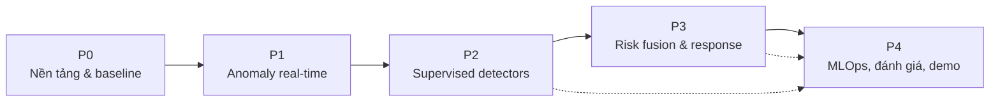

# Kế hoạch triển khai và đánh giá NDR + AI/ML

> Tài liệu này chuyển thiết kế trong [`02-system-design.md`](./02-system-design.md) thành kế hoạch thực hiện theo pha, backlog, tiêu chí nghiệm thu, kế hoạch test/đánh giá và kịch bản demo.  
> Bối cảnh nghiên cứu: [`01-research-report.md`](./01-research-report.md).

---

## 1. Mục tiêu và phạm vi

### 1.1 Mục tiêu bàn giao

1. Hệ thống NDR có thêm lớp AI/ML chạy end-to-end trên lab, không làm hỏng chức năng hiện có.
2. Sáu kịch bản tấn công được phát hiện với metric định lượng, có so sánh trước/sau.
3. Alert có risk score, MITRE mapping, evidence và reason codes.
4. Response automation hoạt động an toàn với allowlist/approval/rollback.
5. Tài liệu thiết kế, model card, runbook, báo cáo đánh giá và demo tái lập được.

### 1.2 Ngoài phạm vi

- Triển khai production multi-site.
- Giải mã TLS/payload.
- Tự động remediation không có human approval.
- Huấn luyện LLM từ đầu.
- Cam kết metric tuyệt đối; mọi ngưỡng là giả thuyết cần đo.

### 1.3 Nguyên tắc thực hiện

| Nguyên tắc | Ý nghĩa |
|---|---|
| Baseline first | Đo rule-only trước khi thêm ML |
| Incremental | Mỗi pha tạo giá trị độc lập, không big bang |
| Replayable | Mọi thí nghiệm chạy lại từ PCAP/log |
| Version everything | Dataset, feature set, model, threshold, dashboard |
| No leakage | Time/group split, label audit |
| Fail open | ML lỗi không làm mất rule/response |
| Human oversight | Auto-block chỉ trong policy |
| Document as you go | Model card, runbook, decision log |

---

## 2. Tổng quan các pha



| Pha | Mục tiêu | Đầu ra chính | Gate |
|---|---|---|---|
| P0 | Dữ liệu sạch, baseline, ground truth | Dataset v0, baseline report, schema | Có thể replay 6 kịch bản |
| P1 | Anomaly detection real-time | Feature pipeline, IF/KitNET, dashboard | Score end-to-end, FP trong ngưỡng |
| P2 | Supervised detectors | D2–D7, model card, đánh giá | Mỗi kịch bản đạt ngưỡng tối thiểu |
| P3 | Risk fusion, response, LLM | Alert queue, playbook, guardrail | End-to-end 6 kịch bản, auto-block an toàn |
| P4 | MLOps, đánh giá cuối, demo | Registry, CI, drift, báo cáo | Tái lập + demo thành công |

---

## 3. P0 — Nền tảng dữ liệu và baseline

### 3.1 Mục tiêu

- Chốt schema log, bật JSON/JA3/JA4/community ID.
- Chuẩn hóa ECS và index template.
- Tạo benign baseline và ground truth cho 6 kịch bản.
- Đo baseline rule-only để so sánh.

### 3.2 Công việc

| ID | Công việc | Đầu ra | Definition of Done | Phụ thuộc |
|---|---|---|---|---|
| P0.1 | Chốt phiên bản Zeek, log schema, package JA3/JA4 | `docs/log-schema.md`, config | Log JSON parse được; có `uid`, `community_id`, JA3/JA4 | — |
| P0.2 | Chuẩn hóa ECS + index template + ILM | `config/elasticsearch/index-templates/` | Raw log vào ES đúng mapping; không dynamic mapping | P0.1 |
| P0.3 | Cấu hình Filebeat gửi bus + ES | `config/filebeat/` | Không mất log khi bus down; retry/spool | P0.1 |
| P0.4 | Xây benign baseline generator | Script + lịch chạy | Có ≥ 3 khung giờ, đủ HTTP/DNS/SSH/SMB/FTP | P0.1 |
| P0.5 | Viết attack harness 6 kịch bản | `tests/replay/scenarios/` | Chạy được bằng một lệnh; có ground truth JSON | P0.1 |
| P0.6 | Chạy biến thể tấn công | Dataset v0 + PCAP | Mỗi kịch bản ≥ 3 biến thể, ≥ 5 lần chạy | P0.5 |
| P0.7 | Replay harness từ PCAP/log | `tests/replay/` | Tái tạo detection tất định; có golden output | P0.5 |
| P0.8 | Baseline rule-only | `reports/baseline.md` | Precision/recall/FP/alert volume cho 6 kịch bản | P0.6 |
| P0.9 | Label store + schema | `pipelines/labels/`, `docs/labeling.md` | Nhãn join được theo time/5-tuple/uid; audit mẫu | P0.6 |

### 3.3 Ground truth JSON mẫu

```json
{
  "run_id": "lab-run-20261001-01",
  "scenario": "c2_beaconing",
  "variant": "jitter_20pct",
  "start_ts": "2026-10-01T10:00:00Z",
  "end_ts": "2026-10-01T10:30:00Z",
  "attacker_ip": "192.168.217.132",
  "victim_ip": "192.168.217.129",
  "tool": "beacon_simulator",
  "mitre_tactic": ["TA0011"],
  "mitre_technique": ["T1071.001", "T1573"],
  "expected_detection": ["D5"],
  "notes": "30s interval, 20% jitter, TLS"
}
```

### 3.4 Gate P0

- Replay được toàn bộ 6 kịch bản từ PCAP/log.
- Có baseline report rule-only.
- Không còn lỗi schema/mapping nghiêm trọng.
- Dataset v0 và label store sẵn sàng cho P1/P2.

---

## 4. P1 — Anomaly detection real-time

### 4.1 Mục tiêu

- Dựng pipeline bus → feature → inference → ES.
- Train Isolation Forest/KitNET trên benign baseline.
- Có dashboard anomaly và đo FP/ngày.

### 4.2 Công việc

| ID | Công việc | Đầu ra | Definition of Done | Phụ thuộc |
|---|---|---|---|---|
| P1.1 | Dựng Redis list/Kafka + cơ chế competing consumer | `docker-compose.yml` | Publish/consume ổn định; có lag metric | P0.3 |
| P1.2 | Raw indexer ghi ECS vào ES + fan-out list cho feature worker | `pipelines/ingest/` | Bulk + retry + DLQ; không mất dữ liệu; demo fan-out đúng | P1.1 |
| P1.3 | Feature worker v1 (conn/dns/ssl/http/ssh) | `pipelines/features/` | Feature snapshot đúng schema; unit test | P1.1 |
| P1.4 | Online store + offline Parquet | Redis + Parquet | TTL, partition, schema registry | P1.3 |
| P1.5 | Train Isolation Forest + KitNET baseline | `models/anomaly/` | Train trên benign; lưu artifact + metric | P1.3 |
| P1.6 | Inference API + detection schema | `serving/inference/` | Healthcheck, batch, p95 < 100 ms | P1.5 |
| P1.7 | Ghi `ndr-detections-*` + dashboard anomaly | Index + Kibana saved objects | Drill-down theo `uid`/host; score timeline | P1.6 |
| P1.8 | Đo FP/ngày và recall sơ bộ | `reports/anomaly.md` | Có số liệu trên benign + 6 kịch bản | P1.7 |

### 4.3 Gate P1

- Detection end-to-end từ log đến Kibana.
- Anomaly score có top features/reason.
- FP/ngày trong ngưỡng tạm thời (đề xuất ≤ 10/ngày trong lab).
- Không ảnh hưởng packet capture/rule hiện có.

---

## 5. P2 — Supervised detectors

### 5.1 Mục tiêu

- Xây dataset v1 có label tin cậy.
- Train và đánh giá D2–D7.
- Có model card, SHAP, calibration.

### 5.2 Thứ tự ưu tiên

1. **D5 Beaconing** — giá trị ML cao nhất.
2. **D7 DNS tunneling** — đặc trưng rõ, dễ demo.
3. **D6 Lateral movement** — giá trị NDR, cần graph features.
4. **D4 Malware download** — cần cẩn thận false positive.
5. **D2 Scan**, **D3 Brute force** — rule đã tốt; ML hỗ trợ slow/distributed.

### 5.3 Công việc

| ID | Công việc | Đầu ra | Definition of Done | Phụ thuộc |
|---|---|---|---|---|
| P2.1 | Dataset v1 + label audit | `training/datasets/` | Time/group split; không leakage; báo cáo phân phối | P0.9 |
| P2.2 | Feature set v1.1 (window/entity) | `pipelines/features/` | Golden test; train/serve parity | P1.3 |
| P2.3 | D5 beaconing model + calibration | `models/beaconing/` | PR-AUC/recall@FPR; model card | P2.1 |
| P2.4 | D7 DNS tunneling model + lexical score | `models/dns_tunnel/` | Recall iodine/dnscat2; FP CDN/AV | P2.1 |
| P2.5 | D6 lateral movement + graph features | `models/lateral/` | Recall PsExec; FP admin/backup | P2.1 |
| P2.6 | D4 malware download model | `models/malware/` | PR-AUC; FP software update | P2.1 |
| P2.7 | D2 scan + D3 brute force | `models/scan/`, `models/bruteforce/` | Slow scan/low-and-slow recall | P2.1 |
| P2.8 | SHAP/reason codes cho từng model | `reports/explainability.md` | Top features ổn định; analyst đọc được | P2.3–P2.7 |
| P2.9 | Đánh giá per-scenario + ablation | `reports/detectors.md` | Có baseline so sánh; CI 95% | P2.8 |

### 5.4 Dataset split

- **Train:** các run cũ hơn, đa dạng biến thể.
- **Validation:** run gần hơn, dùng chọn threshold/hyperparameter.
- **Test:** run mới nhất, không dùng trong train/val; theo nhóm campaign/host pair.
- **Public pretraining:** UWF-ZeekData24/CICIDS/UNSW; chỉ dùng pretrain, test trên lab.
- **Báo cáo:** phân phối lớp, số mẫu, số campaign, missing rate.

### 5.5 Gate P2

- Mỗi detector có model card + metric + threshold + limitation.
- D5/D7 đạt ngưỡng tối thiểu (xem mục 7).
- Không có leakage; split được review.
- Detection có thể drill-down về log gốc.

---

## 6. P3 — Risk fusion, response, LLM triage

### 6.1 Mục tiêu

- Gộp rule + ML + intel + asset thành alert queue duy nhất.
- Tích hợp response an toàn.
- LLM triage optional, có guardrail.

### 6.2 Công việc

| ID | Công việc | Đầu ra | Definition of Done | Phụ thuộc |
|---|---|---|---|---|
| P3.1 | Risk engine scorecard/logistic | `pipelines/risk/` | Risk 0–100 + reasons; unit test | P2.9 |
| P3.2 | Dedup/correlation theo uid/community_id/entity | Risk engine | Giảm ≥ 50% alert thô; không mất evidence | P3.1 |
| P3.3 | Alert schema + MITRE mapping | `docs/alert-schema.md` | 100% alert có MITRE + evidence | P3.2 |
| P3.4 | Response integration + guardrail | `response/` | Allowlist, threshold, TTL, rollback, audit | P3.3 |
| P3.5 | Kibana alert queue + entity timeline + feedback | Saved objects | Analyst triage được; feedback ghi label | P3.4 |
| P3.6 | LLM triage optional | `llm_triage/` | Output schema; no tool execution; audit | P3.5 |
| P3.7 | End-to-end test 6 kịch bản | `reports/e2e.md` | Tất cả kịch bản chạy qua pipeline | P3.5 |

### 6.3 Guardrail checklist

- [ ] Allowlist IP/domain/host quản trị, backup, monitoring, update.
- [ ] Auto-block chỉ risk critical + confidence ≥ 0.9 + không allowlist.
- [ ] Block có TTL, tự gỡ, audit.
- [ ] Rate limit block/alert storm.
- [ ] High/medium cần approval.
- [ ] Response API lỗi → retry/backoff, không block mù.
- [ ] LLM không gọi response API; chỉ summary/đề xuất.
- [ ] Mọi action có audit `ndr-audit-*`.

### 6.4 Gate P3

- Một alert queue duy nhất cho 6 kịch bản.
- Auto-block chỉ xảy ra đúng policy; có rollback.
- Alert có risk, MITRE, evidence, reason code.
- LLM (nếu dùng) không ảnh hưởng quyết định chặn.

---

## 7. P4 — MLOps, đánh giá cuối, demo

### 7.1 Mục tiêu

- Tái lập pipeline; có registry/CI/drift/retraining.
- Đánh giá đầy đủ, so sánh baseline.
- Demo và báo cáo.

### 7.2 Công việc

| ID | Công việc | Đầu ra | Definition of Done | Phụ thuộc |
|---|---|---|---|---|
| P4.1 | MLflow tracking + registry | `training/`, registry | Model + metric + signature + stage | P3.7 |
| P4.2 | CI: lint/test/replay/smoke | `.github/workflows/` | Chạy trên PR; fail nếu golden test sai | P4.1 |
| P4.3 | Drift monitoring + retraining playbook | `docs/mlops.md` | PSI/KS dashboard; trigger rõ ràng | P4.1 |
| P4.4 | Shadow/canary/rollback | Runbook | Thử nghiệm thành công trên model mới | P4.3 |
| P4.5 | Đánh giá cuối + ablation + robustness | `reports/final-evaluation.md` | Đủ bảng/hình; CI 95%; so sánh baseline | P4.4 |
| P4.6 | Demo script + slide + báo cáo | `reports/demo.md`, slide | Demo 6 kịch bản + benign + evasion | P4.5 |
| P4.7 | Runbook/handover | `docs/runbook.md` | Vận hành, troubleshoot, rollback | P4.6 |

### 7.3 Gate P4

- Pipeline tái lập từ repo + dataset version.
- Có báo cáo đánh giá cuối với baseline/ablation/robustness.
- Demo chạy thành công, có fallback nếu ML/service lỗi.
- Tài liệu bàn giao đầy đủ.

---

## 8. Backlog chi tiết (rút gọn)

| ID | Task | Input | Output | DoD | Depends |
|---|---|---|---|---|---|
| P0.1 | Chốt schema Zeek | PDF, môi trường | `log-schema.md` | Log mẫu parse được | — |
| P0.2 | ECS mapping | P0.1 | Index templates | Mapping đúng, không dynamic | P0.1 |
| P0.3 | Filebeat config | P0.1 | Config + test | Không mất log khi bus down | P0.1 |
| P0.4 | Benign generator | Lab | Script + log | Đủ protocol/khung giờ | P0.1 |
| P0.5 | Attack harness | Lab | Script 6 kịch bản | Một lệnh chạy; ground truth | P0.1 |
| P0.6 | Dataset v0 | P0.4/P0.5 | PCAP + log + label | ≥ 5 run/kịch bản, ≥ 3 biến thể | P0.5 |
| P0.7 | Replay harness | P0.6 | Test runner | Golden output tất định | P0.5 |
| P0.8 | Baseline rule-only | P0.6 | Report | Precision/recall/FP/alert volume | P0.6 |
| P0.9 | Label store | P0.6 | Schema + tool | Join được; audit mẫu | P0.6 |
| P1.1 | Bus | P0.3 | Redis list/Kafka | Lag metric; competing consumer/consumer group | P0.3 |
| P1.2 | Raw indexer | P1.1 | Service | Bulk/retry/DLQ | P1.1 |
| P1.3 | Feature worker | P1.1 | Service + tests | Schema + unit test | P1.1 |
| P1.4 | Feature store | P1.3 | Redis + Parquet | TTL/partition/schema | P1.3 |
| P1.5 | Anomaly model | P0.6, P1.3 | Artifact + metrics | Train benign; lưu version | P1.3 |
| P1.6 | Inference API | P1.5 | Service | p95 < 100 ms; healthcheck | P1.5 |
| P1.7 | Detection index/dashboard | P1.6 | Index + dashboard | Drill-down uid/host | P1.6 |
| P1.8 | Anomaly report | P1.7 | Report | FP/ngày + recall sơ bộ | P1.7 |
| P2.1 | Dataset v1 | P0.9 | Parquet + label | Time/group split | P0.9 |
| P2.2 | Feature v1.1 | P1.3 | Feature set | Golden test/parity | P1.3 |
| P2.3 | D5 beaconing | P2.1/P2.2 | Model + card | Metric + threshold | P2.1 |
| P2.4 | D7 DNS tunnel | P2.1/P2.2 | Model + card | Metric + threshold | P2.1 |
| P2.5 | D6 lateral | P2.1/P2.2 | Model + card | Metric + threshold | P2.1 |
| P2.6 | D4 malware | P2.1/P2.2 | Model + card | Metric + threshold | P2.1 |
| P2.7 | D2/D3 | P2.1/P2.2 | Model + card | Metric + threshold | P2.1 |
| P2.8 | Explainability | P2.3–P2.7 | Report | SHAP/reason code | P2.3–P2.7 |
| P2.9 | Detector evaluation | P2.8 | Report | Baseline + ablation | P2.8 |
| P3.1 | Risk engine | P2.9 | Service | Risk + reasons | P2.9 |
| P3.2 | Dedup/correlation | P3.1 | Logic + tests | Giảm 50% alert | P3.1 |
| P3.3 | Alert schema/MITRE | P3.2 | Schema | 100% alert có MITRE | P3.2 |
| P3.4 | Response guardrail | P3.3 | Service | Allowlist/TTL/audit | P3.3 |
| P3.5 | Kibana triage/feedback | P3.4 | Dashboard | Feedback ghi label | P3.4 |
| P3.6 | LLM triage | P3.5 | Service | Schema/guardrail | P3.5 |
| P3.7 | E2E test | P3.5 | Report | 6 kịch bản | P3.5 |
| P4.1 | MLflow/registry | P3.7 | Registry | Stage/signature | P3.7 |
| P4.2 | CI | P4.1 | Workflow | Golden test/smoke | P4.1 |
| P4.3 | Drift/retrain | P4.1 | Dashboard/runbook | Trigger rõ | P4.1 |
| P4.4 | Shadow/canary | P4.3 | Runbook | Thử thành công | P4.3 |
| P4.5 | Final evaluation | P4.4 | Report | Baseline/ablation/robustness | P4.4 |
| P4.6 | Demo/report | P4.5 | Demo + slide | 6 kịch bản + fallback | P4.5 |
| P4.7 | Handover | P4.6 | Runbook | Vận hành/troubleshoot | P4.6 |

---

## 9. Chiến lược test

### 9.1 Test levels

| Level | Mục tiêu | Ví dụ | Công cụ |
|---|---|---|---|
| Unit | Feature/schema/threshold | entropy, window, missing, IPv6 | pytest |
| Integration | Bus → feature → inference → ES | publish log mẫu, assert detection | testcontainers |
| Replay | Tái lập từ PCAP/log | 6 kịch bản, golden output | pytest + PCAP |
| Live | Chạy tấn công thật trong lab | 6 kịch bản + benign | script harness |
| Adversarial | Kiểm tra né tránh | slow scan, jitter beacon, low-entropy DNS | harness biến thể |
| Performance | Throughput/latency/backpressure | bơm log, đo lag/p95 | locust/k6/custom |
| Security | Auth/TLS/secrets/input | scan API, prompt injection | checklist + tool |
| UAT | Analyst dùng được | triage, feedback, explanation | checklist |

### 9.2 Test case trọng yếu

| ID | Test | Kỳ vọng |
|---|---|---|
| T01 | Feature entropy với chuỗi rỗng/1 ký tự | Không crash; giá trị hợp lệ |
| T02 | Window không đủ mẫu | `insufficient_data`, không alert |
| T03 | Late event | State cập nhật; snapshot idempotent |
| T04 | `uid` xuất hiện nhiều log | Correlation đúng |
| T05 | Suricata + Zeek cùng flow | Dedup theo `community_id` |
| T06 | Model mismatch feature version | Inference từ chối, alert “degraded” |
| T07 | Redis down | Filebeat buffer; replay không mất |
| T08 | ES bulk error | Retry/DLQ; không mất detection |
| T09 | Auto-block allowlist | Không block |
| T10 | Response API timeout | Retry; không block mù |
| T11 | LLM prompt injection trong log | Không thực thi; output validate fail |
| T12 | Jittered beacon | Vẫn phát hiện; FP không tăng |
| T13 | Slow scan | Phát hiện; không alert benign monitoring |
| T14 | Low-entropy DNS tunnel | Phát hiện; FP CDN/AV thấp |
| T15 | Drift giả lập | Có cảnh báo drift; retrain playbook |

### 9.3 Golden test

- Lưu một bộ PCAP/log nhỏ + expected detection JSON.
- Chạy replay, so sánh score/alert với tolerance.
- Không dùng test set để tune threshold.
- Cập nhật golden khi có thay đổi có chủ đích, kèm review.

---

## 10. Kế hoạch đánh giá

### 10.1 Ma trận thí nghiệm

| ID | Baseline | Treatment | Metric | Dataset |
|---|---|---|---|---|
| E1 | Rule-only | Rule + D1 anomaly | FP/ngày, recall | Lab v1 |
| E2 | Rule-only | Rule + D5 | Recall jitter, FP | Lab v1 |
| E3 | Rule-only | Rule + D7 | Recall tunnel, FP | Lab v1 |
| E4 | Rule-only | Rule + D6 | Recall PsExec, FP | Lab v1 |
| E5 | Rule-only | Rule + D4 | PR-AUC, FP | Lab v1 |
| E6 | Từng detector | Hybrid + risk fusion | Alert precision, volume | Lab v1 |
| E7 | Full feature | Ablation từng nhóm feature | Delta metric | Lab v1 |
| E8 | Model tĩnh | Retrain/drift | Delta metric | Lab v0→v1 |
| E9 | — | Adversarial variants | Recall drop | Lab v1 |
| E10 | — | Load test | p95 latency, lag | Synthetic |

### 10.2 Metric và ngưỡng đề xuất

| Metric | Ngưỡng đề xuất | Ghi chú |
|---|---|---|
| Recall/kịch bản | ≥ 0.85 | ≥ 5 run, ≥ 3 biến thể |
| PR-AUC (supervised) | ≥ 0.80 | D4–D7 |
| FP/ngày (benign) | ≤ 5 | Lab; production cần hiệu chỉnh |
| Recall @ FPR 1% | ≥ 0.80 | Báo cáo thêm |
| Alert volume reduction | ≥ 50% | Sau dedup/risk fusion |
| MTTD tức thời | ≤ 60 s | Alert tức thời |
| Beacon confirmed | ≤ 15 phút | Hai mức alert |
| p95 inference | < 100 ms | Batch 500–2000 |
| End-to-end p95 | < 60 s | Log → alert |
| Packet loss | < 1% | `capture_loss.log` |
| MITRE coverage | 100% alert | Có tactic/technique |
| Explanation | 100% alert | Top features/reason |

### 10.3 Cách báo cáo

- Bảng per-scenario: precision, recall, F1, PR-AUC, FP/ngày, MTTD.
- Hình: PR curve, confusion matrix, score distribution, alert volume theo thời gian.
- Bảng ablation: feature group removed → delta.
- Bảng robustness: variant → recall/FP.
- Bảng hệ thống: throughput, latency, lag, packet loss.
- Phụ lục: per-run results, CI 95%, tham số model, commit hash.

### 10.4 Tiêu chí “đủ tốt” cho đồ án

- Tất cả 6 kịch bản phát hiện được trong ít nhất 4/5 lần chạy.
- D5/D7 có cải thiện rõ so với rule-only (recall hoặc FP).
- Risk fusion giảm alert thô ≥ 50% mà không mất detection quan trọng.
- Auto-block không chặn nhầm allowlist trong test.
- Demo tái lập được từ script.

---

## 11. Kịch bản demo

### 11.1 Cấu trúc demo

1. **Baseline benign (2–3 phút):** duyệt web, DNS, SSH admin, SMB share; dashboard không có alert critical.
2. **Sáu kịch bản tấn công:** chạy tuần tự hoặc song song có kiểm soát; show alert, evidence, MITRE, response.
3. **Biến thể né tránh:** slow scan, jitter beacon, low-entropy DNS; show ML bắt được trong khi rule đơn thuần có thể bỏ sót.
4. **Feedback loop:** analyst đánh dấu TP/FP; show label store/dashboard.
5. **Fallback:** tắt ML service, show rule vẫn hoạt động; bật lại, show recovery.

### 11.2 Demo theo kịch bản

| # | Kịch bản | Công cụ / cách làm | Log để show | Alert kỳ vọng | Response |
|---|---|---|---|---|---|
| 1 | Port scan | `nmap -sS -T4 <victim>` + slow scan | `conn.log`: nhiều S0/REJ, nhiều dst port | D2 + rule; MITRE T1046 | Alert |
| 2 | Brute force | `hydra` SSH/FTP với wordlist lab | `ssh.log` auth_attempts, `ftp.log` 530 | D3 + rule; T1110 | Block IP + notify |
| 3 | Malware download | HTTP server nội bộ + file test/EICAR; mô phỏng IOC | `http.log`, `files.log`, `intel.log` | D4 + intel; T1105 | Block source + notify |
| 4 | C2 beaconing | Beacon simulator (30s, jitter 20%, TLS) | `conn.log` interval, `ssl.log` JA4/SNI | D5; T1071.001/T1573 | Alert + isolate host (manual) |
| 5 | Lateral movement | `impacket-psexec` trong lab | `smb_mapping.log`, `smb_files.log`, `dce_rpc.log` | D6 + rule; T1021.002/T1569.002 | Block internal IP + notify |
| 6 | DNS tunneling | `iodine`/`dnscat2` trong lab | `dns.log`: entropy, subdomain, query rate | D7; T1048/T1071.004 | Block IP + notify |

> **Lưu ý:** chỉ chạy trong lab được phép, trên VM attacker/victim của đồ án. Không dùng lệnh/tool ngoài phạm vi đồ án.

### 11.3 Dashboard cần show

- **NDR Overview:** alert theo risk/level, top src/dst, MITRE tactic.
- **Alert detail:** score, threshold, top features, related `uid`, evidence.
- **Entity timeline:** chuỗi sự kiện của victim/attacker.
- **Model health:** score distribution, FP rate, drift.
- **Response audit:** block/rollback, approval.

### 11.4 Câu chuyện demo

> "Rule bắt được hành vi đã biết. ML bổ sung khả năng phát hiện biến thể và ưu tiên cảnh báo. Risk engine gộp tín hiệu, giảm nhiễu. Response chỉ tự động khi đủ tin cậy. Analyst feedback quay lại cải thiện model."

---

## 12. Traceability với yêu cầu đồ án

| Yêu cầu (PDF) | Thành phần đáp ứng | Kiểm chứng |
|---|---|---|
| Visibility: log đầy đủ, dashboard | Zeek JSON + Filebeat + ES + Kibana | P0/P1; dashboard |
| Detect: scan, brute force, malware, lateral, beacon, DNS | Rule + D1–D7 | P2; per-scenario eval |
| MITRE mapping | Detection/alert schema + risk engine | P3; 100% alert có MITRE |
| Response: block + notify + whitelist + unblock | Response orchestrator + guardrail | P3; T09/T10; audit |
| Hunt: truy vết theo uid/community_id | Raw ECS + entity timeline | P1/P3; drill-down |
| Incident procedure | Playbook + runbook | P3/P4; demo |
| Human resource | Tài liệu, dashboard, training | P4; handover |
| Performance < 1 phút | Latency budget + SLO | P4; load test |
| Storage 12 tháng | ILM + index template | P0; kiểm tra ILM |
| Security: TLS, RBAC, secrets | TLS/mTLS, API key, Vault/env | P0/P4; checklist |
| Availability | Healthcheck/restart/fallback | P4; failure test |

---

## 13. Risk register

| ID | Rủi ro | Khả năng | Tác động | Giảm thiểu | Owner |
|---|---|---|---|---|---|
| R1 | Thiếu label/ground truth | Cao | Cao | Controlled harness, label audit, pretrain | Nhóm data |
| R2 | False positive cao | Cao | Cao | Baseline, calibration, risk fusion, allowlist | Nhóm ML |
| R3 | Rò rỉ train/test | Trung bình | Cao | Time/group split, review | Nhóm ML |
| R4 | Drift | Cao | Trung bình | PSI/KS, retrain, shadow | Nhóm MLOps |
| R5 | Model không giải thích được | Trung bình | Trung bình | SHAP, reason code, model card | Nhóm ML |
| R6 | Auto-block sai | Thấp | Cao | Guardrail, approval, TTL, rollback | Nhóm response |
| R7 | LLM hallucination/prompt injection | Trung bình | Trung bình | RAG allowlist, output schema, human review | Nhóm LLM |
| R8 | Tài nguyên lab hạn chế | Trung bình | Trung bình | Model nhẹ, batch, Docker limit | Nhóm hạ tầng |
| R9 | Mất log/backpressure | Trung bình | Cao | Filebeat spool, bus retention, monitor lag | Nhóm hạ tầng |
| R10 | Thiếu thời gian/task quá tải | Trung bình | Cao | Ưu tiên P0/P1/D5/D7; cắt P4 nếu cần | Nhóm trưởng |
| R11 | Khác biệt Zeek version/log schema | Trung bình | Trung bình | Chốt schema sớm; test parse | Nhóm data |
| R12 | Privacy/legal | Thấp | Trung bình | Metadata-only, pseudonymize, retention | Nhóm trưởng |

---

## 14. Definition of Done

Một hạng mục được coi là Done khi:

- [ ] Code/config đã merge, có review.
- [ ] Unit/integration test liên quan pass.
- [ ] Schema/feature/model version được ghi.
- [ ] Metric được đo trên test set lab, có baseline so sánh.
- [ ] Model card/runbook cập nhật (nếu là model).
- [ ] Dashboard/alert hiển thị đúng.
- [ ] Không làm hỏng chức năng cũ (rule/response).
- [ ] Có hướng dẫn chạy lại/troubleshoot.
- [ ] Demo hoặc replay chạy được.

---

## 15. Cấu trúc báo cáo đồ án gợi ý

1. **Giới thiệu:** bối cảnh NDR, mục tiêu, phạm vi.
2. **Cơ sở lý thuyết và related work:** NDR, Zeek, AI/ML cho IDS/NDR, các công trình liên quan.
3. **Phân tích hệ thống hiện tại:** kiến trúc, 6 kịch bản, khoảng trống.
4. **Thiết kế tích hợp AI/ML:** kiến trúc hybrid, data pipeline, feature, model, risk fusion.
5. **Triển khai:** môi trường lab, service, cấu hình, các quyết định kỹ thuật.
6. **Đánh giá:** baseline, per-scenario, ablation, robustness, hiệu năng.
7. **Thảo luận:** ưu điểm, hạn chế, false positive, drift, chi phí vận hành.
8. **Kết luận và hướng phát triển:** graph/sequence model, LLM an toàn hơn, production hardening.
9. **Tài liệu tham khảo.**
10. **Phụ lục:** schema, model card, script, kết quả per-run.

---

## 16. Phụ lục

### A. Detection event mẫu

Xem [`02-system-design.md`](./02-system-design.md), mục 4.3–4.6.

### B. Zeek config gợi ý

```zeek
# local.zeek
@load policy/tuning/json-logs.zeek
@load policy/protocols/ssl/ja3

# JA4: cài package JA4 của FoxIO, sau đó load theo tên package thực tế
# @load packages/ja4

redef Site::local_nets = {
  192.168.217.0/24,
  192.168.230.0/24
};
```

**Kiểm tra trước khi dùng:**

- Tên log TLS thực tế (`ssl.log`/`tls.log`).
- Tên package JA4 và field sinh ra (`ja4`, `ja4s`).
- `community_id` có trong `conn.log` hay cần load script.
- Định dạng timestamp/JSON và rotation.

### C. Filebeat config gợi ý

```yaml
filebeat.inputs:
  - type: filestream
    id: zeek-json
    paths:
      - /opt/zeek/logs/current/*.log
    parsers:
      - ndjson:
          target: ""
          add_error_key: true

processors:
  - add_host_metadata: {}
  - add_fields:
      target: event
      fields:
        module: zeek

output.redis:
  hosts: ["${REDIS_HOST}:6379"]
  password: "${REDIS_PASSWORD}"
  key: "zeek:raw"
  db: 0
  timeout: 5s
```

> Nếu dùng Kafka, thay `output.redis` bằng `output.kafka`; nếu cần ghi raw ES trực tiếp, dùng `output.elasticsearch` hoặc một consumer riêng.

### D. Docker Compose skeleton

Xem [`02-system-design.md`](./02-system-design.md), mục 9.4.

### E. Checklist trước demo

- [ ] NTP đồng bộ trên tất cả VM.
- [ ] Zeek/Suricata/Filebeat/ES/Kibana/ML service healthcheck.
- [ ] Index template + dashboard đã import.
- [ ] Model đúng version + threshold.
- [ ] Allowlist đã cấu hình.
- [ ] Ground truth + script 6 kịch bản chạy được.
- [ ] Có kịch bản fallback khi ML/ES/response lỗi.
- [ ] Dữ liệu demo được reset sạch trước khi chạy.
- [ ] Có ảnh chụp/ghi hình dashboard.
- [ ] Có slide giải thích kiến trúc và metric.
