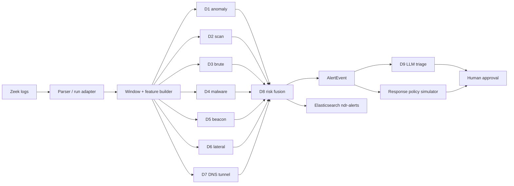

# Báo cáo ngữ cảnh đồ án NDR + ML/LLM

> Tài liệu handoff cho người tiếp nhận codebase.  
> Cập nhật: 2026-11-23.  
> Trạng thái artifact hiện tại: **synthetic demo profile**, public dataset chỉ là baseline.

---

## 1. Tóm tắt điều hành

Đồ án bổ sung lớp AI/ML/LLM vào hệ thống NDR hiện có (Zeek + Suricata + Filebeat + Elasticsearch/Kibana + response automation).

Nguyên tắc:

```text
Rule-first, ML-augmented, LLM-assisted.
Metadata-only, không đọc payload.
Không auto-block; con người quyết định.
```

Ba lớp chính:

1. **ML detection**: D1 anomaly + D2–D7 supervised detectors.
2. **Risk fusion**: D8 deterministic, gộp alert, dedup, risk scorecard, MITRE.
3. **LLM triage**: D9 giải thích alert high/critical; response simulator chỉ đề xuất.

Pipeline hiện tại là **batch/offline**, chưa phải streaming real-time.

---

## 2. Phạm vi và giới hạn

### Đã có

- D1–D7 model, feature, calibration, SHAP.
- D8 risk fusion.
- D9 mock LLM + OpenAI-compatible provider.
- Response policy simulator.
- Synthetic corpus + public dataset adapters.
- Docker inference image.
- ELK alert export.

### Chưa có

- Kết nối lab thật để lấy Zeek logs.
- Calibration trên benign lab.
- Production model cho D2/D3/D4/D5.
- D6 real SMB dataset; D6 hiện synthetic.
- Real-time streaming (Kafka/Redis).
- Tích hợp pfSense thật.

### Không được claim

```text
Không claim model 1.0 là lab/production.
Không claim auto-block.
Không claim đã validate trên NDR thật.
```

---

## 3. Kiến trúc hệ thống NDR hiện có

Lab NDR:

```text
Sensor 192.168.230.130
  Zeek 9.0.1
  Suricata
  Filebeat

ELK 192.168.230.131
  Elasticsearch 9.5.6
  Kibana 9.5.6

pfSense 192.168.230.2
  response automation / blocked_ips
```

Vùng mạng:

```text
LAN     192.168.217.0/24
MGMT    192.168.230.0/24
WAN     192.168.85.0/24
```

---

## 4. Kiến trúc AI/ML/LLM



Điểm quan trọng:

- D1 **không tạo alert cuối**; chỉ corroboration.
- D2–D7 là seed alert.
- D9 và response là **hai nhánh song song**, không phụ thuộc nhau.
- D9 không gọi response; response không dùng LLM.
- Human approval là cổng cuối.

---

## 5. Data contract

### 5.1. Input Zeek

Parser hiện đọc được:

```text
conn, dns, ssh, ftp, http, files, ssl,
intel, smb_mapping, smb_files, dce_rpc
```

Parser hỗ trợ cả:

```text
nested id:    {"id": {"orig_h": ...}}
flat Zeek:    {"id.orig_h": ...}
```

### 5.2. FeatureSnapshot

```text
snapshot_id
feature_set_version
window {start, end, size_sec}
entity {type, src_ip, dst_ip, domain, ...}
features {name: float}
context {conn_count, uids, ...}
label
```

### 5.3. DetectionEvent

```text
timestamp
rule {id, name, version}
model {name, version, type}
score
threshold
is_alert
top_features [{name, value, z, shap}]
entity
window
uids
snapshot_id
```

### 5.4. AlertEvent

```text
alert_id
timestamp / first_seen / last_seen
risk 0..100
level low|medium|high|critical
count
confidence
reasons
scenario
entities
evidence {detections, uids, models, rules, anomaly_detections}
mitre {tactic, technique}
response
ai
```

### 5.5. TriageResult

```text
alert_id
summary
evidence
hypotheses
actions
mitre
confidence
caveats
model
```

---

## 6. Pipeline ML chi tiết

```text
Zeek log
→ parse record
→ group theo entity + window
→ tính feature
→ model score
→ calibration
→ threshold
→ DetectionEvent
→ D8 fusion
→ AlertEvent
→ D9 / response
```

### 6.1. Calibration

D2–D7 dùng isotonic calibration trên validation.

Điểm cần hiểu:

```text
score thô không phải xác suất
isotonic map score → xác suất thực nghiệm
threshold chọn theo FP/ngày
```

Công thức threshold:

```text
W = số window benign/ngày
F = target FP/ngày
q = 1 - F/W
threshold = quantile(benign_scores, q)
```

Guard không còn ép threshold lên trên `max_benign` cho mọi trường hợp:

```text
if quantile <= 0: move just above collapsed benign mass
if validation recall at guard >= 0.5: use guard
else: keep target-FP quantile
```

Cách cũ `if threshold >= max_benign: nextafter(max_benign, inf)` làm validation luôn 0 FP nhưng đẩy threshold lên quá cao, khiến D3/D4 recall = 0. Sau khi sửa, retrain public D3/D4 cho recall 1.0 nhưng FP/ngày rất cao (D3 1152, D4 4320 trên test nhỏ), xác nhận vấn đề chính vẫn là domain shift/threshold target, không phải model ranking. Synthetic vẫn dùng guard vì validation recall tại guard cao, nên các test synthetic tiếp tục đạt FP/ngày <= 10.

### 6.2. SHAP

D2–D7 dùng native TreeSHAP của LightGBM.

- SHAP giải thích vì sao score cao.
- Không phải xác suất.
- Không phải nhân quả.
- D1 dùng z-score top feature, không phải SHAP.

---

## 7. Danh mục detector

| ID | Tên | Model | Input | Entity/window | Feature | Rule | MITRE/stage |
|---|---|---|---|---|---|---|---|
| D1 | Anomaly | Isolation Forest + RobustScaler | conn | host/300s | 18 | `NDR-ML-ANOM-001` | corroboration |
| D2 | Port scan | LightGBM + isotonic + SHAP | conn | src/300s | 9 | `NDR-ML-SCAN-001` | TA0007, T1046, stage 1 |
| D3 | Brute force | LightGBM + isotonic + SHAP | ssh/ftp/conn | (src,service)/300s | 9 | `NDR-ML-BRUTE-001` | TA0006, T1110, stage 2 |
| D4 | Malware download | LightGBM + isotonic + SHAP | http/files/ssl/intel | HTTP request/1s | 22 | `NDR-ML-MALWARE-001` | TA0011, T1105, stage 3 |
| D5 | C2 beacon | LightGBM + IForest + isotonic | conn | host pair/600s | 22 | `NDR-ML-BEACON-001` | TA0011, T1071.001/T1573, stage 4 |
| D6 | Lateral movement | LightGBM + isotonic + SHAP | smb_mapping/smb_files/dce_rpc | src/600s | 13 | `NDR-ML-LATERAL-001` | TA0008/TA0002, T1021.002/T1569.002, stage 5 |
| D7 | DNS tunnel | LightGBM + isotonic + lexical blend | dns | host-domain/300s | 26 | `NDR-ML-DNS-001` | TA0010/TA0011, T1048/T1071.004, stage 6 |

---

## 8. D8 — Risk fusion

D8 là scorecard deterministic, không train.

```text
Input: DetectionEvent D1–D7
→ lọc is_alert
→ dedup (rule.id, entity_key)
→ correlation 30 phút
→ D1 corroboration
→ detector agreement
→ kill-chain advance
→ enrichment
→ risk score
→ MITRE
→ AlertEvent
```

Risk base:

```text
max(seed score, anomaly score)
```

Cộng/trừ:

```text
+10 intel
+10 asset critical
+10 detector agreement
+5  kill-chain advance
-10 allowlist
-10 historical FP > 0.5
```

Level:

```text
critical >=85
high >=70
medium >=40
low <40
```

D8 chỉ khuyến nghị response; không auto-block.

---

## 9. D9 — LLM triage

Luồng:

```text
Alert high/critical
→ build prompt từ alert + playbook RAG
→ LLM (mock hoặc OpenAI-compatible)
→ strict JSON TriageOutput
→ guardrail
→ TriageResult
→ audit JSONL
```

Guardrail:

- schema chặt;
- MITRE phải khớp alert;
- evidence phải có thật;
- redact secret;
- audit `prompt_sha256`;
- không auto-block.

Provider:

```text
MockProvider: deterministic, không network
OpenAICompatibleProvider: gọi endpoint /v1
```

Eval hiện tại:

```text
6 alert
schema 1.00
MITRE 1.00
evidence 1.00
actionability 1.00
hallucination 0.00
```

Đây là eval harness, không phải đánh giá LLM thật trên lab.

---

## 10. Response policy

```text
risk >=85
confidence >=0.9
allowlist 192.168.217.129
TTL 3600s
rate limit 10/phút
```

Hành động:

```text
apply / deny / rollback / audit
```

Chỉ là simulator:

- không gọi pfSense;
- không chặn thật;
- con người duyệt.

Demo E2E:

```text
35 allowed
5 denied
0 allowlisted
```

---

## 11. Dataset

### 11.1. Synthetic

Dùng cho demo:

```text
D1: 4 benign + 4 attack
D2–D7: 6 benign + 6 attack
```

Generator:

```text
ndr/synth/generate.py
ndr/synth/scan.py
ndr/synth/brute.py
ndr/synth/malware.py
ndr/synth/beacon.py
ndr/synth/lateral.py
ndr/synth/dns.py
```

### 11.2. Public

| Nguồn | Dùng cho | Dung lượng |
|---|---|---:|
| UWF-ZeekData24 CSV | D1/D2 conn | 10 MB + 0.6 MB |
| CIC-IDS-2017 Tuesday/Friday | D3/D4 benign/D5/D2 fallback | 19.3 GB |
| MTA PCAP | D4 attack/benign, SMB | 611 MB |
| GraphTunnel | D7 tunnel | 234 MB |
| D6 synthetic | D6 | generated |

UWF full Parquet sampled: **conn-only**, 27 cột, 50,444 rows/tuần. Không có ssh/http/smb/dns.

---

## 12. Kết quả hiện tại

### 12.1. Active artifact — synthetic demo

`models/` và Docker image hiện tại dùng synthetic.

| ID | Recall | FP/ngày | PR-AUC |
|---|---:|---:|---:|
| D1 | 0.75 | 6 | — |
| D2 | 1.00 | 0.00 | 1.00 |
| D3 | 1.00 | 0.00 | 1.00 |
| D4 | 1.00 | 0.00 | 1.00 |
| D5 | 1.00 | 0.00 | 1.00 |
| D6 | 1.00 | 0.00 | 1.00 |
| D7 | 1.00 | 0.00 | 1.00 |

**Synthetic test rất nhỏ (1 benign + 2 attack cho D2–D7), không đại diện lab.**

### 12.2. Public baseline

| ID | Recall | FP/ngày | PR-AUC | Ghi chú |
|---|---:|---:|---:|---|
| D1 | — | — | — | unsupervised |
| D2 | 0.000 | 0 | 0.016 | label NAT, scan thưa |
| D3 | 1.000 | 1152 | 0.667 | sau khi sửa threshold guard; FP quá cao |
| D4 | 1.000 | 4320 | 0.667 | MTA benign; sau guard fix; FP quá cao |
| D5 | 0.003 | 69 | 0.105 | CIC Bot không beacon |
| D6 | — | — | — | synthetic-only |
| D7 | 0.845 | 355 | 0.892 | CIC benign + GraphTunnel |

Public baseline chứng minh **domain shift**, chưa production.

---

## 13. Runtime và CLI

### 13.1. Synthetic demo

```bash
uv run ndr prelab-demo --workdir /tmp/prelab --seed 42
```

### 13.2. Dataset preparation

```bash
uv run ndr dataset-prep \
  --root data/datasets \
  --out data/runs \
  --zeek scripts/zeek-docker
```

### 13.3. Training

```bash
uv run ndr dataset-train \
  --runs data/runs \
  --models models-public
```

### 13.4. Inference

```bash
uv run ndr infer \
  --raw /opt/zeek/logs/current \
  --models models \
  --workdir /tmp/ndr-infer \
  --window-minutes 10
```

Hoặc:

```bash
uv run ndr infer \
  --runs data/runs/d7 \
  --models models \
  --workdir /tmp/ndr-infer
```

### 13.5. ELK export

```bash
uv run ndr elk-export \
  --alerts data/lab/eval/alerts.jsonl \
  --index ndr-alerts
```

Env:

```text
NDR_ES_URL
NDR_ES_API_KEY hoặc NDR_ES_USER/NDR_ES_PASSWORD
NDR_ES_CA_CERT
```

---

## 14. Docker deployment

Artifact:

```text
Dockerfile
.dockerignore
deploy/run-infer.sh
deploy/ndr.env.example
deploy/ndr-infer.cron
```

Build:

```bash
docker build -t ndr-ml:0.2.0 .
docker save ndr-ml:0.2.0 | gzip > dist/ndr-ml-0.2.0.tar.gz
```

Image hiện tại:

```text
dist/ndr-ml-0.2.0.tar.gz = 128 MB
```

Smoke test synthetic D3/D7:

```text
total_detections = 10
total_alerts = 3
```

Deploy script chạy mỗi 10 phút:

```cron
*/10 * * * * ndr /opt/ndr/run-infer.sh
```

`run-infer.sh`:

```text
rsync Zeek current
→ docker run ndr infer --raw
→ export ELK
```

Chưa chạy trên ML VM thật vì thiếu `ML_HOST`, ELK credentials/CA.

---

## 15. Test

```text
213 tests collected
uv run pytest -q => pass
```

Test bao gồm:

- contracts;
- parser Zeek;
- feature;
- train/score;
- risk;
- LLM guardrail;
- response;
- lab adapter;
- dataset adapter;
- runtime infer;
- Docker-independent integration.

---

## 16. Trạng thái hiện tại

| Hạng mục | Trạng thái |
|---|---|
| D1–D7 model | Có |
| Synthetic demo | Tốt |
| Public baseline | Yếu |
| Docker inference | Chạy |
| ELK export | Có code, chưa target test |
| D9 LLM | Mock + remote client |
| Response | Simulator |
| Production | Chưa |

Artifact:

```text
data/datasets   23 GB
data/runs      958 MB
models         5.4 MB
dist           128 MB
```

Git:

```text
Working tree chưa commit.
data/, models/, artifacts/smoke/ được ignore.
```

---

## 17. Production còn thiếu gì?

1. Benign lab 24–72h.
2. Calibration threshold trên target.
3. D2 dense scan/real scan labels.
4. D3 benign auth thật hoặc threshold target.
5. D4 cùng domain benign/attack + threshold.
6. D5 real beacon PCAP; CIC Bot không đủ.
7. D6 real SMB hoặc chấp nhận synthetic.
8. ELK credentials/CA.
9. Shadow mode + feedback.
10. Drift/retrain/rollback.

Không có benign target thì không thể production.

---

## 18. Handoff checklist

```text
[ ] uv run pytest -q
[ ] uv run ndr prelab-demo --workdir /tmp/prelab --seed 42
[ ] uv run ndr infer --runs data/runs/d7 --models models --workdir /tmp/infer
[ ] docker build -t ndr-ml:0.2.0 .
[ ] docker run --rm ndr-ml:0.2.0 --help
[ ] không bật cron nếu chưa calibrate target
[ ] không auto-block
[ ] không commit data/models/artifacts
```

---

## 19. Câu chốt cho người mới

> Đồ án này không thay thế NDR rule-based. Nó bổ sung ML để bắt biến thể, D8 để ưu tiên, D9 để giải thích, response simulator để đề xuất. Synthetic 1.0 là kiểm chứng pipeline; public baseline cho thấy domain shift; production cần benign target calibration.

